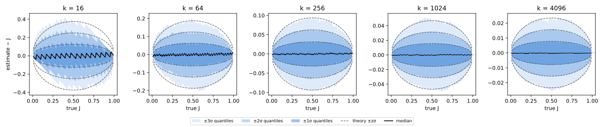
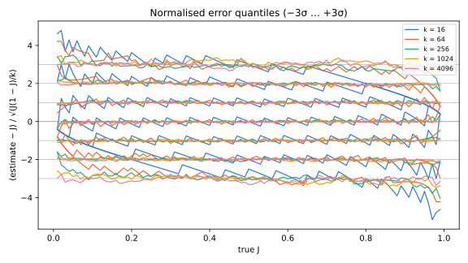
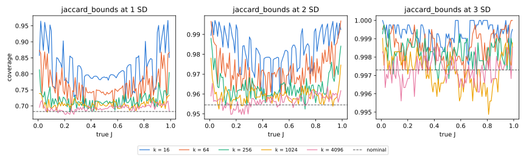

<!--
Licensed to the Apache Software Foundation (ASF) under one
or more contributor license agreements.  See the NOTICE file
distributed with this work for additional information
regarding copyright ownership.  The ASF licenses this file
to you under the Apache License, Version 2.0 (the
"License"); you may not use this file except in compliance
with the License.  You may obtain a copy of the License at

  http://www.apache.org/licenses/LICENSE-2.0

Unless required by applicable law or agreed to in writing,
software distributed under the License is distributed on an
"AS IS" BASIS, WITHOUT WARRANTIES OR CONDITIONS OF ANY
KIND, either express or implied.  See the License for the
specific language governing permissions and limitations
under the License.
-->

# MinHash accuracy against J: what the plots show

This page explains the 3 plots of the `minhash-accuracy-j` profile (MH-16), and
what they show for the run at commit 1895347. A person wrote this page. The
notebook does not write it, so a new run does not change it.

## The experiment

For each k in {16, 64, 256, 1024, 4096}, and for each true Jaccard similarity J
in {0.01, 0.02 … 0.99}, the profile makes 4096 trials. Each trial uses a
different sketch seed. It compares two sets with an exactly known J, and it
records the estimate, the error, and the interval from `jaccard_bounds()`.

## Theory

**The model.** Assume that the k slots act as independent random hash
functions. Then each slot matches with probability J, and the number of
matching slots M has a Binomial(k, J) distribution. The estimate is Ĵ = M/k. So:

- the mean of Ĵ is exactly J: the estimate has no bias;
- the standard deviation (SD) of Ĵ is √(J(1 − J)/k);
- Ĵ can take only the k + 1 values 0, 1/k … 1.

The MH-6 statistical tests check the assumption of independent slots.

**What each plot should show.**

| Plot | Expected result | Expected deviation, and why |
|---|---|---|
| Absolute error | The ±z σ bands are on the dashed lines ±z √(J(1 − J)/k). The width is largest at J = 0.5. Each step from k to 4k halves it. | When kJ or k(1 − J) is small, the bands are asymmetric. Example: at k = 16 and J = 0.01, about 85 % of trials have no match, so the median error is exactly −J. |
| Normalised error | The error (M − kJ)/√(kJ(1 − J)) is standard normal when kJ(1 − J) is large (about 10 or more). The 7 quantile lines are on −3 … 3. | When kJ(1 − J) is small, the error is discrete and skewed (skewness (1 − 2J)/√(kJ(1 − J))). Its lowest possible value is −√(kJ/(1 − J)): −0.40 at k = 16 and J = 0.01. |
| Coverage | The coverage is at the nominal rate or above it. | `jaccard_bounds()` uses `bounds_binomial_proportions`, an approximation of the Clopper–Pearson interval. Each bound has a tail probability δ = Φ(−s), so the nominal two-sided coverage is 1 − 2δ. Exact Clopper–Pearson intervals are conservative, and M is discrete, so the coverage is above nominal at small k and at J near 0 or 1. Against J, the coverage is a sawtooth. The library approximates the interval, so its coverage can also be a little below nominal. |

**Noise from 4096 trials.** The profile measures each value from 4096 trials,
so each measured value has a random error of its own:

| Value | Expected range |
|---|---|
| BiasOverSE | about N(0, 1) at each point. With 495 independent points, the largest size would be about 3 to 3.5. The points share their trials, so they are not independent. |
| SDRatio | 1 ± 0.033 (3 × the relative standard error 1/√(2 × 4096)). |
| Cover1SD, Cover2SD, Cover3SD | the coverage ± 3 × 0.73, 0.33 and 0.08 points (the binomial standard error at the nominal rate). |

## 1. Absolute error (`accuracy_j_error.svg`)

**Purpose.** This plot shows how large the error is, for each k. Use it to
choose k: read the band width at the J values that are important to you.

**How to read it.** There is one panel for each k. The black line is the median
error. The 3 blue bands contain the middle 68.3 %, 95.4 % and 99.7 % of the
4096 errors. The dashed lines are the theory values ±1, ±2 and ±3 SD.

**Findings.**

- The bands follow the dashed lines at all k and all J. The measured SD is
  between 0.971 and 1.025 of the theory SD at every point.
- The error is largest at J = 0.5, and it is smaller near J = 0 and J = 1.
- Each step from k to 4k halves the error. For example, at J = 0.5 the SD is
  0.125 at k = 16 and 0.0078 at k = 4096.
- The median does not measure bias here, because Ĵ is discrete and skewed. At
  k = 16 the median moves in steps of 1/16 (−0.04 to +0.04), and it is −J for
  J ≤ 0.04, as the Theory section expects. At k ≥ 1024 it is within 0.16 SD of
  zero. The mean error measures bias: for k ≤ 1024, |BiasOverSE| is at most
  2.6, so the estimate shows no bias there.
- One small effect is not visible on the plot. At k = 4096, the mean error is
  negative at all 99 values of J, and its largest size is 4.1 standard errors
  (J = 0.02). In absolute terms it is −1.4 × 10⁻⁴, against an SD of
  2.2 × 10⁻³. The 99 points share the same trials, so they are not independent.
  This is reported on CD-395 for a decision.

## 2. Normalised error (`accuracy_j_normalised.svg`)

**Purpose.** This plot checks the shape of the error distribution, not only its
size. It divides each error by the theory SD. If the theory is correct, the
result has a standard normal distribution for every k and every J.

**How to read it.** All k are on one axis, with one colour for each k. Each k
has 7 lines: the quantiles at −3σ, −2σ, −1σ, the median, +1σ, +2σ and +3σ. The
grey lines at 0, ±1, ±2 and ±3 are the values for a standard normal
distribution. A line on its grey line means a match with theory.

**Findings.**

- Where kJ(1 − J) is large, the quantiles are on the grey lines. At k = 1024
  and k = 4096, every quantile is within 0.5 of its normal value at every J. At
  k = 256 this is true except at J ≤ 0.03 and J ≥ 0.97. For example, at k = 256
  and J = 0.01 (kJ(1 − J) ≈ 2.5), the quantiles go from −1.61 to 4.67. At
  k = 64 it fails at 26 of the 99 J values, all at J ≤ 0.2 or J ≥ 0.84.
- These deviations are the ones that the Theory section expects where
  kJ(1 − J) is below about 10.
- At k = 16, the lines are steps, and the ±3σ lines are at about ±2.7. With 16
  slots, the estimate can take only 17 values, so its distribution cannot be
  exactly normal. k = 64 is between the two.

## 3. Coverage of `jaccard_bounds()` (`accuracy_j_coverage.svg`)

**Purpose.** `jaccard_bounds(other, s)` gives a lower and an upper bound for J,
at s = 1, 2 or 3 SD. A user relies on these bounds, so this plot checks that
they are correct. "Coverage" is the fraction of the 4096 trials in which the
interval contains the true J.

**How to read it.** There is one panel for each value of s. Each line is one k.
The dashed line is the nominal coverage: the coverage that an interval of ±s SD
has for a normal distribution (68.27 %, 95.45 % and 99.73 %).

- A line on the dashed line means that the bounds are correct.
- A line above the dashed line means that the bounds are wider than necessary.
  They are safe, but they claim less precision than the sketch has.
- A line below the dashed line means that the bounds are too narrow. This is
  the case that would be a problem.

With 4096 trials, the coverage has a random error of its own: one standard
error is 0.73 points at 1 SD, 0.33 points at 2 SD and 0.08 points at 3 SD.

**Findings.**

- At small k, the bounds are wider than necessary. At 2 SD, the mean coverage
  is 98.3 % at k = 16 and 97.2 % at k = 64, against a nominal 95.45 %. The
  effect is largest for J below 0.1 or above 0.9.
- The cause is the method. `jaccard_bounds()` approximates the Clopper–Pearson
  interval, which is conservative when M is discrete: at small k, and at J
  near 0 or 1. See "Theory".
- As k increases, the coverage comes down to the nominal rate. At k = 4096 the
  mean coverage is 69.4 %, 95.7 % and 99.73 %, against 68.27 %, 95.45 % and
  99.73 %.
- No point is significantly below nominal. Some points at k ≥ 64 are a
  little below the dashed line, but none is more than 3 standard errors below.
  The lowest values are 67.4 % (1 SD), 94.97 % (2 SD) and 99.49 % (3 SD).

**Conclusion for users.** The bounds are safe at every k and J in this profile.
At k ≤ 64 they are wider than necessary, so a user can trust them, but the true
uncertainty is smaller than they say.
