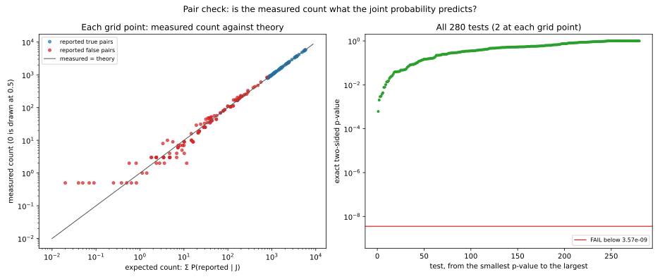
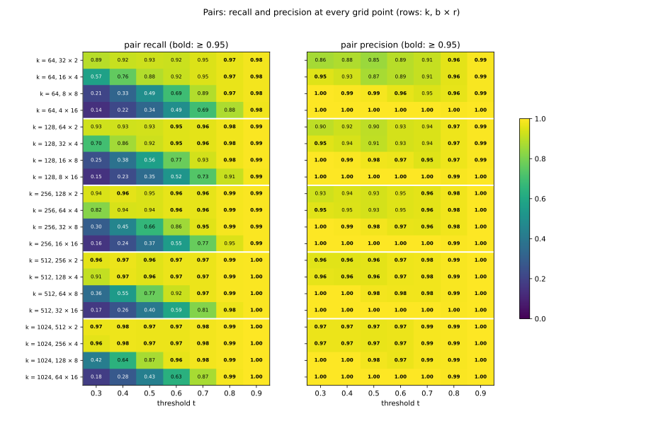
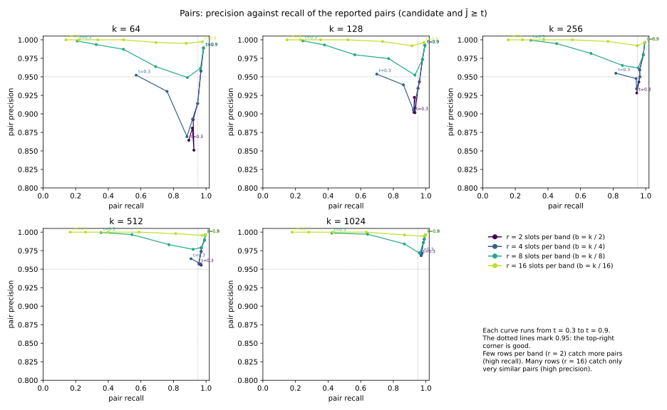
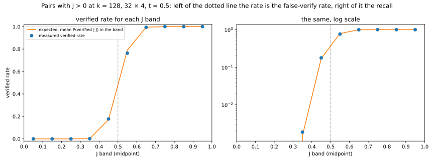
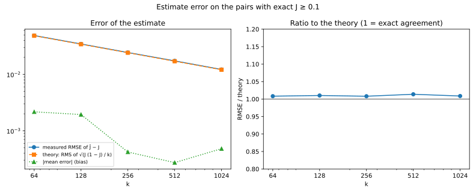
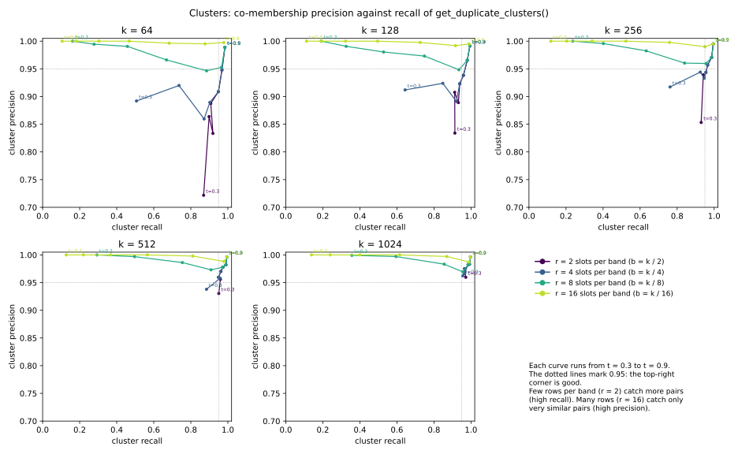
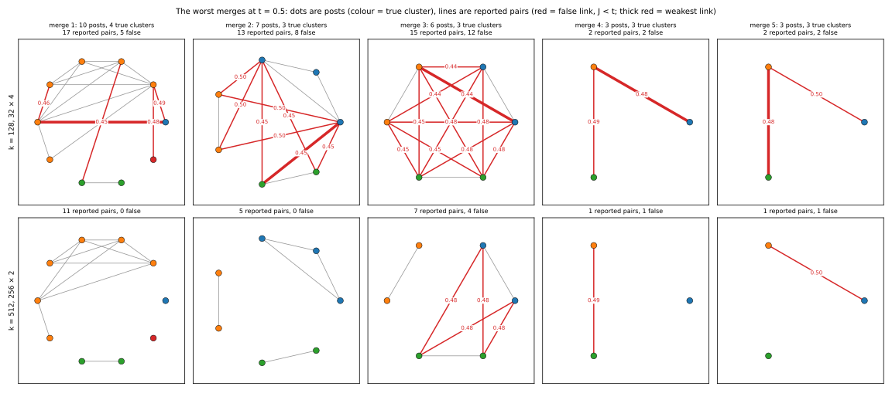
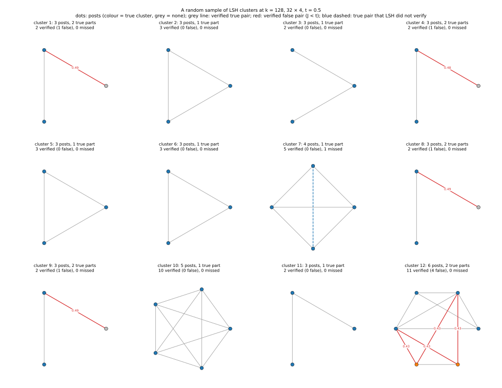

<!--
Licensed to the Apache Software Foundation (ASF) under one
or more contributor license agreements.  See the NOTICE file
distributed with this work for additional information
regarding copyright ownership.  The ASF licenses this file
to you under the Apache License, Version 2.0 (the
"License"); you may not use this file except in compliance
with the License.  You may obtain a copy of the License at

  http://www.apache.org/licenses/LICENSE-2.0

Unless required by applicable law or agreed to in writing,
software distributed under the License is distributed on an
"AS IS" BASIS, WITHOUT WARRANTIES OR CONDITIONS OF ANY
KIND, either express or implied.  See the License for the
specific language governing permissions and limitations
under the License.
-->

# Full-data precision and recall of the sketch and the LSH clusters on 20 Newsgroups

Written by `build/lsh_20news_full` (`FULL=1 ./run_demos.sh`). The ticket is MH-14b. The tables for every grid point are in `lsh_20news_full_pairs.tsv`, `lsh_20news_full_clusters.tsv` and `lsh_20news_full_estimates.tsv`. `plots/lsh_20news_full.py` draws the figures from them.

## Definitions

- **Data point:** one post. It is the set of its 5-word shingles: runs of 5 consecutive lower-case words, after the header block of the post is removed. An indexed post has at least 1 shingle.
- **Pair:** two different indexed posts, in any order.
- **Exact J:** |A ∩ B| / |A ∪ B| of the two shingle sets. **Estimated J (Ĵ):** the share of the k slots whose values are equal.
- **True pair at t:** a pair with exact J ≥ t.
- **Candidate pair:** a pair whose band keys are equal in at least 1 band.
- **Verified pair:** a candidate pair with Ĵ ≥ t. The TSV columns `Reported`, `ReportedTrue` and `ReportedFalse`, and the word "reported" in the figures, mean the verified pairs.
- **Pair recall:** verified true pairs ÷ true pairs. **Pair precision:** verified true pairs ÷ verified pairs.
- **True cluster:** a connected group of 2 or more posts that true pairs link. **LSH cluster:** a connected group of 2 or more posts that verified pairs link (`get_duplicate_clusters()`).
- **Co-membership pair:** two posts in the same cluster. It includes posts that only a chain links, so their exact J can be below t.
- **Cluster recall:** the co-membership pairs that are in the true clusters and in the LSH clusters ÷ the co-membership pairs of the true clusters. **Cluster precision:** the same count ÷ the co-membership pairs of the LSH clusters. These are not the same quantities as pair recall and pair precision, because a cluster counts every pair that a chain links.
- **Merge:** an LSH cluster that joins 2 or more true clusters. Here a post in no true cluster counts as a true cluster of its own. **Split:** a true cluster that LSH divides into 2 or more parts.

## LSH guarantee

An LSH family is (r, cr, p1, p2)-sensitive if pairs at distance d ≤ r collide with probability at least p1, and pairs at distance d ≥ cr collide with probability at most p2. For MinHash the distance is the Jaccard distance d = 1 − J. One slot collides with probability exactly J = 1 − d, so p1 = 1 − r and p2 = 1 − cr. Bands amplify it. A pair is a candidate with probability f(J) = 1 − (1 − J^rows)^b. This curve rises with J, so for any r and c, p1 = f(1 − r) and p2 = f(1 − c·r). For example, at 32 bands × 4 rows: d ≤ 0.3 (J ≥ 0.7) gives p1 ≥ 0.9998; d ≥ 0.7 (J ≤ 0.3) gives p2 ≤ 0.2292.

In this definition, r is a distance radius. It is not the rows per band (r) of the grid. The S-curve check (MH-14, MH-19) and the pair check of this report test f as an equality at many values of J, which is stronger than the two inequalities.

## Data

- posts: 19997
- indexed posts (at least one shingle of 5 words): 19925
- pairs of indexed posts: 198492850
- pairs with exact J > 0 (stored in the exact-pair cache): 581369
- grid: k ∈ {64, 128, 256, 512, 1024}, r ∈ {2, 4, 8, 16}, b = k / r, t ∈ {0.3, …, 0.9}: 140 points

Truth: a true pair at t has exact J ≥ t, with J from `news20::jaccard` on the MH-8 shingle sets. The true clusters at t are the connected components of the true pairs. Verified pairs: the candidates (equal band keys in at least one band) with Ĵ ≥ t. The LSH clusters are `get_duplicate_clusters()`. The program asserts, at each grid point, that the components of the verified pairs equal them.

## Prefix assert: PASS

Each sketch is built directly at its k. For each k < 1024 and each indexed post, the k signature must equal the first k slots of the k = 1024 signature.

- signatures checked: 79700
- signatures that differ: 0

## Cross-posts: PASS

Each pair of indexed posts that share a `Message-ID` must be in one true cluster and in one LSH cluster, at every grid point.

- cross-post pairs: 538
- (pair, grid point) cases not in one cluster: 0

## Pair check: PASS (140 of 140 grid points pass)

P(verified | J) is the joint probability that some band is all-equal and at least m = ⌈t k⌉ slots are equal, with each slot equal independently with probability J. It is Σ_{s ≥ m} P(Binomial(k, J) = s) q(s), where q(s) is the probability that s uniformly placed equal slots fill some band (a dynamic program over the bands). At each grid point, two counts are tested with the exact two-sided Poisson-binomial p-value: the verified true pairs against Σ P(verified | J) over the true pairs (recall), and the verified false pairs against Σ P(verified | J) over the pairs with 0 < J < t (precision). Pairs with J = 0 add 0. A test passes when p ≥ 1e-06 / 280 = 3.57e-09. If the pairs were independent, a correct index would fail some test with a probability of at most 1e-06. They are not: pairs that share a post use the same signature, so their outcomes are positively correlated, the counts spread more than the Poisson-binomial allows, and the p-values are too small. So this bound is not exact. The margin here is wide: the smallest p-value is in `lsh_20news_full_pairs.tsv` and the figure below. MH-14 checks the S-curve on independent synthetic pairs for this reason.

How to read it: on the left, each dot is one count at one grid point. A dot on the line means that the measured count equals the theory. On the right, the p-values of all tests are sorted. A test fails only below the red line.

## Recommended k

For each t: the smallest k with a (b, r) whose pair recall and pair precision are both ≥ 0.95 and whose pair check passes. The best (b, r) at that k has the largest min(recall, precision), ties by the smaller r.

| t | k | b × r | recall | precision |
|---:|---:|---|---:|---:|
| 0.3 | 512 | 256 × 2 | 0.9590 | 0.9568 |
| 0.4 | 512 | 128 × 4 | 0.9682 | 0.9572 |
| 0.5 | 512 | 256 × 2 | 0.9551 | 0.9578 |
| 0.6 | 512 | 256 × 2 | 0.9699 | 0.9739 |
| 0.7 | 256 | 128 × 2 | 0.9625 | 0.9593 |
| 0.8 | 64 | 8 × 8 | 0.9658 | 0.9617 |
| 0.9 | 64 | 32 × 2 | 0.9840 | 0.9889 |

## Pair recall and precision at each grid point

How to read it: each row is one (k, b × r), and each column is one t. Bright cells are near 1, and bold values are at least 0.95. Recall rises and precision falls as r gets smaller.

How to read it: one panel for each k, and one curve for each r. Each curve runs from t = 0.3 to t = 0.9. The dotted lines mark 0.95, so a point in the top-right corner meets the target of a recommended k.

Each cell is recall / precision. A FAIL marks a failed pair check.

| k | b × r | t = 0.3 | t = 0.4 | t = 0.5 | t = 0.6 | t = 0.7 | t = 0.8 | t = 0.9 |
|---:|---|---|---|---|---|---|---|---|
| 64 | 32 × 2 | 0.8943 / 0.8644 | 0.9160 / 0.8808 | 0.9254 / 0.8510 | 0.9209 / 0.8924 | 0.9483 / 0.9140 | 0.9680 / 0.9578 | 0.9840 / 0.9889 |
| 64 | 16 × 4 | 0.5711 / 0.9523 | 0.7604 / 0.9304 | 0.8829 / 0.8693 | 0.9168 / 0.8930 | 0.9483 / 0.9140 | 0.9680 / 0.9578 | 0.9840 / 0.9889 |
| 64 | 8 × 8 | 0.2102 / 0.9984 | 0.3262 / 0.9936 | 0.4932 / 0.9872 | 0.6907 / 0.9638 | 0.8857 / 0.9491 | 0.9658 / 0.9617 | 0.9840 / 0.9889 |
| 64 | 4 × 16 | 0.1398 / 1.0000 | 0.2182 / 1.0000 | 0.3352 / 1.0000 | 0.4935 / 1.0000 | 0.6931 / 0.9964 | 0.8783 / 0.9952 | 0.9766 / 0.9975 |
| 128 | 64 × 2 | 0.9269 / 0.9021 | 0.9288 / 0.9223 | 0.9326 / 0.9016 | 0.9516 / 0.9345 | 0.9600 / 0.9434 | 0.9787 / 0.9735 | 0.9938 / 0.9926 |
| 128 | 32 × 4 | 0.6984 / 0.9537 | 0.8620 / 0.9392 | 0.9230 / 0.9052 | 0.9510 / 0.9345 | 0.9600 / 0.9434 | 0.9787 / 0.9735 | 0.9938 / 0.9926 |
| 128 | 16 × 8 | 0.2453 / 0.9986 | 0.3779 / 0.9931 | 0.5634 / 0.9798 | 0.7715 / 0.9746 | 0.9324 / 0.9523 | 0.9787 / 0.9735 | 0.9938 / 0.9926 |
| 128 | 8 × 16 | 0.1480 / 1.0000 | 0.2309 / 1.0000 | 0.3549 / 1.0000 | 0.5218 / 1.0000 | 0.7339 / 0.9977 | 0.9146 / 0.9919 | 0.9877 / 0.9963 |
| 256 | 128 × 2 | 0.9448 / 0.9282 | 0.9577 / 0.9432 | 0.9451 / 0.9338 | 0.9634 / 0.9499 | 0.9625 / 0.9593 | 0.9851 / 0.9798 | 0.9938 / 0.9963 |
| 256 | 64 × 4 | 0.8166 / 0.9548 | 0.9410 / 0.9477 | 0.9439 / 0.9338 | 0.9634 / 0.9499 | 0.9625 / 0.9593 | 0.9851 / 0.9798 | 0.9938 / 0.9963 |
| 256 | 32 × 8 | 0.2954 / 0.9994 | 0.4538 / 0.9949 | 0.6640 / 0.9816 | 0.8566 / 0.9654 | 0.9533 / 0.9621 | 0.9851 / 0.9798 | 0.9938 / 0.9963 |
| 256 | 16 × 16 | 0.1562 / 1.0000 | 0.2437 / 1.0000 | 0.3745 / 1.0000 | 0.5508 / 1.0000 | 0.7681 / 0.9978 | 0.9477 / 0.9922 | 0.9938 / 0.9963 |
| 512 | 256 × 2 | 0.9590 / 0.9568 | 0.9697 / 0.9555 | 0.9551 / 0.9578 | 0.9699 / 0.9739 | 0.9708 / 0.9790 | 0.9904 / 0.9893 | 0.9951 / 0.9963 |
| 512 | 128 × 4 | 0.9075 / 0.9641 | 0.9682 / 0.9572 | 0.9551 / 0.9578 | 0.9699 / 0.9739 | 0.9708 / 0.9790 | 0.9904 / 0.9893 | 0.9951 / 0.9963 |
| 512 | 64 × 8 | 0.3556 / 0.9995 | 0.5451 / 0.9967 | 0.7719 / 0.9831 | 0.9203 / 0.9768 | 0.9700 / 0.9790 | 0.9904 / 0.9893 | 0.9951 / 0.9963 |
| 512 | 32 × 16 | 0.1665 / 1.0000 | 0.2599 / 1.0000 | 0.3994 / 1.0000 | 0.5880 / 1.0000 | 0.8132 / 0.9980 | 0.9765 / 0.9956 | 0.9951 / 0.9963 |
| 1024 | 512 × 2 | 0.9706 / 0.9691 | 0.9760 / 0.9714 | 0.9707 / 0.9684 | 0.9723 / 0.9717 | 0.9842 / 0.9858 | 0.9893 / 0.9904 | 0.9975 / 0.9963 |
| 1024 | 256 × 4 | 0.9600 / 0.9721 | 0.9760 / 0.9714 | 0.9707 / 0.9684 | 0.9723 / 0.9717 | 0.9842 / 0.9858 | 0.9893 / 0.9904 | 0.9975 / 0.9963 |
| 1024 | 128 × 8 | 0.4232 / 0.9988 | 0.6422 / 0.9972 | 0.8677 / 0.9841 | 0.9616 / 0.9714 | 0.9842 / 0.9858 | 0.9893 / 0.9904 | 0.9975 / 0.9963 |
| 1024 | 64 × 16 | 0.1797 / 1.0000 | 0.2805 / 1.0000 | 0.4310 / 1.0000 | 0.6340 / 1.0000 | 0.8682 / 0.9962 | 0.9861 / 0.9946 | 0.9975 / 0.9963 |

## Verified rate for each J band

Report only. The pairs with J > 0 are cut into bands of width 0.1, and J = 1 is in the last band. The verified rate of a band depends only on the J values of its pairs, not on the mix of pairs in a dataset, so it is the figure to compare across datasets and with the theory. In a band at or above t, the verified rate is the recall for pairs of that J. In a band below t, it is the false-verify rate. The expected rate is the mean of P(verified | J) over the pairs of the band. All grid points are in `lsh_20news_full_bands.tsv`.

At k = 128, 32 × 4, t = 0.5:

| J band | pairs | verified | verified rate | expected rate |
|---|---:|---:|---:|---:|
| [0.0, 0.1) | 555818 | 0 | 0.0000 | 0.0000 |
| [0.1, 0.2) | 14751 | 0 | 0.0000 | 0.0000 |
| [0.2, 0.3) | 4819 | 0 | 0.0000 | 0.0000 |
| [0.3, 0.4) | 2149 | 4 | 0.0019 | 0.0015 |
| [0.4, 0.5) | 1338 | 237 | 0.1771 | 0.1710 |
| [0.5, 0.6) | 800 | 611 | 0.7638 | 0.7907 |
| [0.6, 0.7) | 495 | 492 | 0.9939 | 0.9947 |
| [0.7, 0.8) | 262 | 262 | 1.0000 | 1.0000 |
| [0.8, 0.9) | 125 | 125 | 1.0000 | 1.0000 |
| [0.9, 1.0] | 812 | 812 | 1.0000 | 1.0000 |

How to read it: the dots are the measured verified rate of each band, and the line is the expected rate. The dotted line marks t. Right of it, the rate is the recall for pairs of that J; left of it, the rate is the false-verify rate. The right panel shows the same rates on a log scale, so small rates are visible (a band with no verified pair is not drawn there).

## Estimate error

On the stored pairs with exact J ≥ 0.1. The ratio is the RMSE divided by the RMS of √(J (1 − J) / k), so 1 is the theory.

How to read it: on the left, the measured RMSE (blue) lies on the theory (orange), and it halves when k grows 4 times. The bias (green) is much smaller than the RMSE. On the right, the ratio is near 1 at every k.

| k | pairs | mean error | RMSE | RMS theory SD | ratio |
|---:|---:|---:|---:|---:|---:|
| 64 | 25551 | 0.002169 | 0.048771 | 0.048371 | 1.0083 |
| 128 | 25551 | 0.001942 | 0.034553 | 0.034204 | 1.0102 |
| 256 | 25551 | 0.000421 | 0.024382 | 0.024186 | 1.0081 |
| 512 | 25551 | -0.000273 | 0.017337 | 0.017102 | 1.0138 |
| 1024 | 25551 | 0.000482 | 0.012199 | 0.012093 | 1.0088 |

## Clusters at k = 128, 32 × 4, t = 0.5 (the MH-14 setting)

Co-membership: a pair of posts is in one cluster. A post alone counts as a component of its own, so a merge can join a true cluster and a post that is in no true cluster. All grid points are in `lsh_20news_full_clusters.tsv`.

How to read it: as the pair figure, but for pairs of posts in one cluster of `get_duplicate_clusters()` against pairs in one true cluster.

- LSH clusters: 1648; true clusters: 1644
- co-membership precision: 0.8911 (2537 of 2847 pairs)
- co-membership recall: 0.9212 (2537 of 2754 pairs)
- merges (LSH clusters that join 2 or more true components): 154
- splits (true clusters that LSH splits): 134
- largest LSH cluster: 10 posts; largest true cluster: 10 posts

The 5 worst merges (most true components, then most posts), each with its weakest link: the verified pair of the cluster with the lowest exact J.

| true components | posts | weakest link | exact J | 3 shared shingles |
|---:|---:|---|---:|---|
| 4 | 10 | `rec.sport.baseball/104383`, `rec.sport.baseball/105082` | 0.4227 | `0062 lafibm lafayette edu vb30`, `14691229 0062 lafibm lafayette edu`, `15apr93 14691229 0062 lafibm lafayette` |
| 3 | 7 | `alt.atheism/53385`, `alt.atheism/53646` | 0.4482 | `1 in the beginning god`, `1qlapk d7v morrow stanford edu`, `3rd debate cobb alexia lis` |
| 3 | 6 | `alt.atheism/53061`, `alt.atheism/53115` | 0.4388 | `3rd debate cobb alexia lis`, `a cobb and i won`, `alexia lis uiuc edu with` |
| 3 | 3 | `rec.autos/103051`, `rec.autos/103063` | 0.4840 | `a catylitic converter i d`, `a lot of particulate matter`, `about legislation being discussed to` |
| 3 | 3 | `rec.autos/103711`, `rec.autos/103740` | 0.4751 | `1st wait 2 3 seconds`, `2 3 seconds and then`, `24326 74 uupcb cutting hou` |

How to read it: each column is one merge of the table above, in the same order. Each dot is a post, coloured by its true cluster at t = 0.5. Each line is a verified pair, labelled with its exact J. A grey line joins posts of one true cluster. A red line has J < t, so it is a false link that joins 2 true clusters, and the thickest red line is the weakest link. The top row is the MH-14 setting (k = 128, 32 × 4). The bottom row shows the same posts at k = 512, 256 × 2, with only the pairs among these posts. The data is in `lsh_20news_full_merges.tsv`.

### A random sample of the clusters

12 of the 249 LSH clusters with at least 3 posts at this setting, chosen by the smallest XXHash64 (seed 1) of the smallest post index of each cluster. 5 of them contain a merge.

How to read it: each panel is one LSH cluster. Each dot is a post, coloured by its true cluster at t = 0.5, and a grey dot is in no true cluster. A solid line is a verified pair, labelled with its exact J, and it is red when J < t. A dashed line is a true pair (J ≥ t) between drawn posts that LSH did not verify; the chain still puts both posts in the cluster. The data is in `lsh_20news_full_sample_clusters.tsv`.

## The 20 true pairs with the highest J

Ties by post index. The shingles show whether quoted text or boilerplate makes the pairs similar.

| posts | exact J | 3 shared shingles |
|---|---:|---|
| `alt.atheism/51129`, `talk.religion.misc/82761` | 1.0000 | `a contradiction of the second`, `a disordered liquid overall the`, `a god more likely besides` |
| `alt.atheism/51137`, `talk.religion.misc/82762` | 1.0000 | `000 years ago none of`, `1 10 114 lists 5`, `10 000 years ago none` |
| `alt.atheism/51138`, `talk.religion.misc/82764` | 1.0000 | `000 horse stalls in one`, `000 in another are just`, `4 000 in another are` |
| `alt.atheism/51166`, `talk.religion.misc/82768` | 1.0000 | `1ph4c8 8j6 shrike und ac`, `8j6 shrike und ac za`, `a full stomache would you` |
| `alt.atheism/51167`, `talk.religion.misc/82769` | 1.0000 | `a child points out that`, `a cool name for a`, `and mark i may see` |
| `alt.atheism/51168`, `talk.religion.misc/82770` | 1.0000 | `about the rna world as`, `absolute giberish and i would`, `and i would post the` |
| `alt.atheism/51207`, `talk.religion.misc/82791` | 1.0000 | `004902 25370 scic intel com`, `11694 rambo atlanta dg com`, `1993apr3 004902 25370 scic intel` |
| `alt.atheism/51248`, `talk.religion.misc/82803` | 1.0000 | `a bit but now i`, `a list of biblical contradictions`, `and cleaned it up a` |
| `alt.atheism/51257`, `talk.religion.misc/82805` | 1.0000 | `01742 fax 508 369 8272`, `082500 28753 smds com rh`, `1 ciliates which have a` |
| `alt.atheism/51264`, `talk.religion.misc/82809` | 1.0000 | `190122 26169 radian uucp markbr`, `1993apr2 190122 26169 radian uucp`, `26169 radian uucp markbr radian` |
| `alt.atheism/51289`, `talk.religion.misc/82811` | 1.0000 | `1ph4c8 8j6 shrike und ac`, `1pq63o n7t access digex net`, `8j6 shrike und ac za` |
| `alt.atheism/53060`, `talk.religion.misc/83532` | 1.0000 | `3rd debate cobb alexia lis`, `a closed or open system`, `a closed system have you` |
| `alt.atheism/53061`, `talk.religion.misc/83533` | 1.0000 | `3rd debate cobb alexia lis`, `8 mac michael a cobb`, `a cobb and i won` |
| `alt.atheism/53063`, `talk.religion.misc/83534` | 1.0000 | `3rd debate cobb alexia lis`, `a change here s an`, `a cobb and i won` |
| `alt.atheism/53074`, `talk.religion.misc/83545` | 1.0000 | `1576 734879396 po cwru edu`, `1qj9gq mg7 horus ap mchp`, `734879396 po cwru edu kmr4` |
| `alt.atheism/53076`, `talk.religion.misc/83549` | 1.0000 | `a choice between a peaceful`, `a lock on morals etc`, `a lock on the absolute` |
| `alt.atheism/53077`, `talk.religion.misc/83550` | 1.0000 | `140493214334 spac at1 59 rice`, `1577 734879611 po cwru edu`, `1qjahh mrs horus ap mchp` |
| `alt.atheism/53079`, `talk.religion.misc/83551` | 1.0000 | `1 a fair equivalent or`, `1qjahh mrs horus ap mchp`, `2 monetary or material worth` |
| `alt.atheism/53080`, `talk.religion.misc/83552` | 1.0000 | `1 for all of the`, `1 in what sense are`, `1 wouldn t it yes` |
| `alt.atheism/53084`, `talk.religion.misc/83553` | 1.0000 | `a joke who could be`, `a moment and look at`, `above the ten commandments and` |

Overall: PASS
