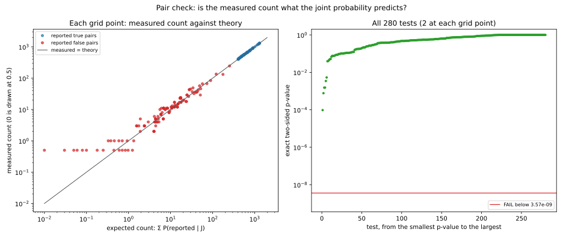
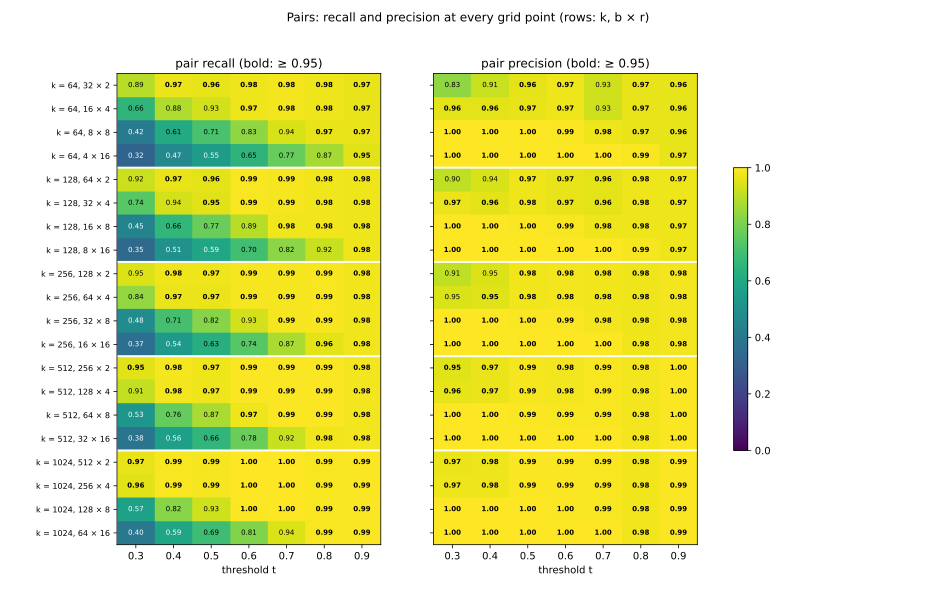
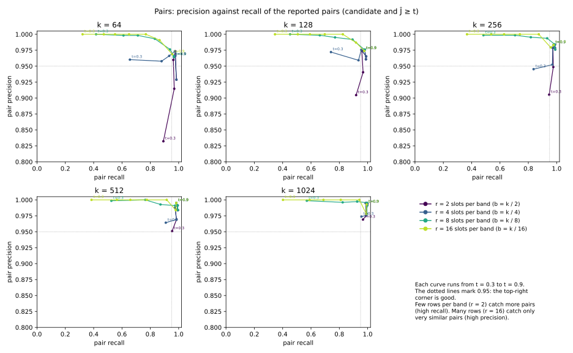
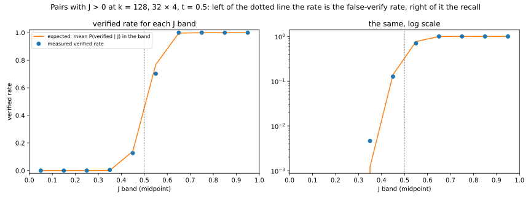
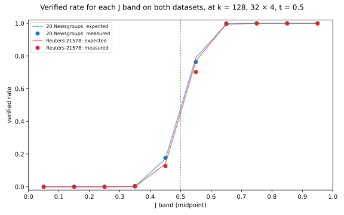
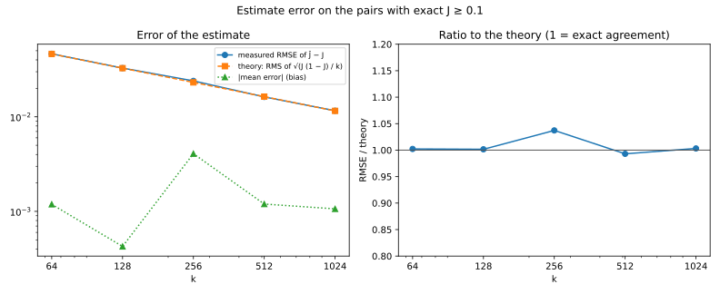
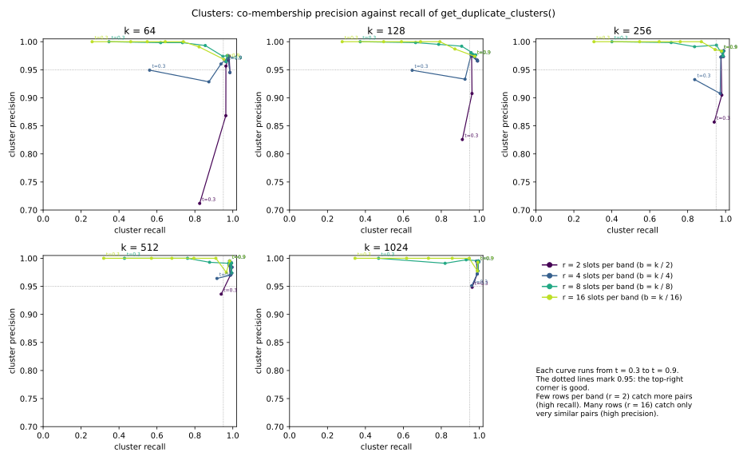
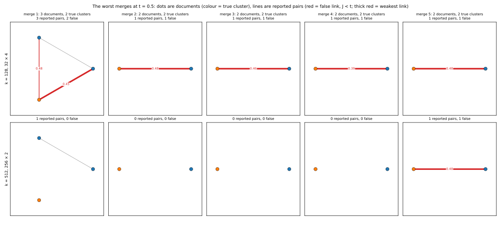
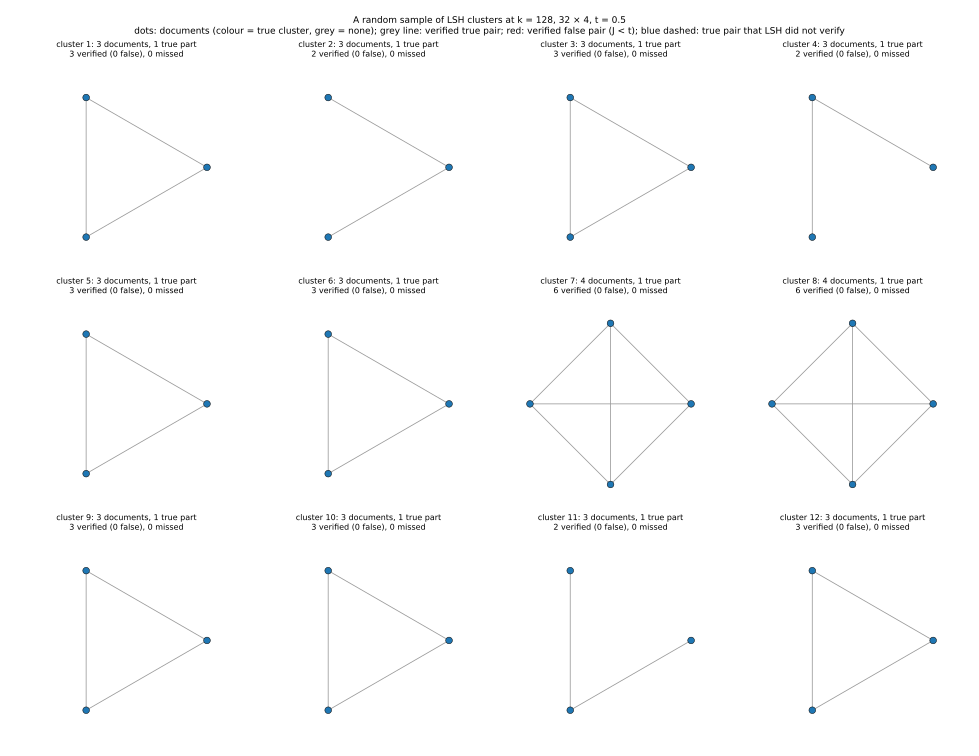

<!--
Licensed to the Apache Software Foundation (ASF) under one
or more contributor license agreements.  See the NOTICE file
distributed with this work for additional information
regarding copyright ownership.  The ASF licenses this file
to you under the Apache License, Version 2.0 (the
"License"); you may not use this file except in compliance
with the License.  You may obtain a copy of the License at

  http://www.apache.org/licenses/LICENSE-2.0

Unless required by applicable law or agreed to in writing,
software distributed under the License is distributed on an
"AS IS" BASIS, WITHOUT WARRANTIES OR CONDITIONS OF ANY
KIND, either express or implied.  See the License for the
specific language governing permissions and limitations
under the License.
-->

# Full-data precision and recall of the sketch and the LSH clusters on Reuters-21578

Written by `build/lsh_reuters_full` (`FULL=1 ./run_demos.sh`). The ticket is MH-14c. The tables for every grid point are in `lsh_reuters_full_pairs.tsv`, `lsh_reuters_full_clusters.tsv` and `lsh_reuters_full_estimates.tsv`. `plots/lsh_20news_full.py` draws the figures from them.

## Definitions

- **Data point:** one document. It is the set of its 5-word shingles: runs of 5 consecutive lower-case words, in the `<TITLE>` and the `<BODY>` of the document, joined by a newline, with the SGML entities decoded. An indexed document has at least 1 shingle.
- **Pair:** two different indexed documents, in any order.
- **Exact J:** |A ∩ B| / |A ∪ B| of the two shingle sets. **Estimated J (Ĵ):** the share of the k slots whose values are equal.
- **True pair at t:** a pair with exact J ≥ t.
- **Candidate pair:** a pair whose band keys are equal in at least 1 band.
- **Verified pair:** a candidate pair with Ĵ ≥ t. The TSV columns `Reported`, `ReportedTrue` and `ReportedFalse`, and the word "reported" in the figures, mean the verified pairs.
- **Pair recall:** verified true pairs ÷ true pairs. **Pair precision:** verified true pairs ÷ verified pairs.
- **True cluster:** a connected group of 2 or more documents that true pairs link. **LSH cluster:** a connected group of 2 or more documents that verified pairs link (`get_duplicate_clusters()`).
- **Co-membership pair:** two documents in the same cluster. It includes documents that only a chain links, so their exact J can be below t.
- **Cluster recall:** the co-membership pairs that are in the true clusters and in the LSH clusters ÷ the co-membership pairs of the true clusters. **Cluster precision:** the same count ÷ the co-membership pairs of the LSH clusters. These are not the same quantities as pair recall and pair precision, because a cluster counts every pair that a chain links.
- **Merge:** an LSH cluster that joins 2 or more true clusters. Here a document in no true cluster counts as a true cluster of its own. **Split:** a true cluster that LSH divides into 2 or more parts.

## LSH guarantee

An LSH family is (r, cr, p1, p2)-sensitive if pairs at distance d ≤ r collide with probability at least p1, and pairs at distance d ≥ cr collide with probability at most p2. For MinHash the distance is the Jaccard distance d = 1 − J. One slot collides with probability exactly J = 1 − d, so p1 = 1 − r and p2 = 1 − cr. Bands amplify it. A pair is a candidate with probability f(J) = 1 − (1 − J^rows)^b. This curve rises with J, so for any r and c, p1 = f(1 − r) and p2 = f(1 − c·r). For example, at 32 bands × 4 rows: d ≤ 0.3 (J ≥ 0.7) gives p1 ≥ 0.9998; d ≥ 0.7 (J ≤ 0.3) gives p2 ≤ 0.2292.

In this definition, r is a distance radius. It is not the rows per band (r) of the grid. The S-curve check (MH-14, MH-19) and the pair check of this report test f as an equality at many values of J, which is stronger than the two inequalities.

## Data

- documents: 21578
- indexed documents (at least one shingle of 5 words): 20840
- pairs of indexed documents: 217142380
- pairs with exact J > 0 (stored in the exact-pair cache): 822287
- grid: k ∈ {64, 128, 256, 512, 1024}, r ∈ {2, 4, 8, 16}, b = k / r, t ∈ {0.3, …, 0.9}: 140 points

Truth: a true pair at t has exact J ≥ t, with J from `news20::jaccard` on the Reuters-21578 shingle sets (the decoded `<TITLE>` and `<BODY>`). The true clusters at t are the connected components of the true pairs. Verified pairs: the candidates (equal band keys in at least one band) with Ĵ ≥ t. The LSH clusters are `get_duplicate_clusters()`. The program asserts, at each grid point, that the components of the verified pairs equal them.

## Prefix assert: PASS

Each sketch is built directly at its k. For each k < 1024 and each indexed document, the k signature must equal the first k slots of the k = 1024 signature.

- signatures checked: 83360
- signatures that differ: 0

## Identical shingle sets: PASS

Each pair of indexed documents with identical shingle sets must be in one true cluster and in one LSH cluster, at every grid point.

- pairs with identical shingle sets: 333
- (pair, grid point) cases not in one cluster: 0

## Pair check: PASS (140 of 140 grid points pass)

P(verified | J) is the joint probability that some band is all-equal and at least m = ⌈t k⌉ slots are equal, with each slot equal independently with probability J. It is Σ_{s ≥ m} P(Binomial(k, J) = s) q(s), where q(s) is the probability that s uniformly placed equal slots fill some band (a dynamic program over the bands). At each grid point, two counts are tested with the exact two-sided Poisson-binomial p-value: the verified true pairs against Σ P(verified | J) over the true pairs (recall), and the verified false pairs against Σ P(verified | J) over the pairs with 0 < J < t (precision). Pairs with J = 0 add 0. A test passes when p ≥ 1e-06 / 280 = 3.57e-09. If the pairs were independent, a correct index would fail some test with a probability of at most 1e-06. They are not: pairs that share a document use the same signature, so their outcomes are positively correlated, the counts spread more than the Poisson-binomial allows, and the p-values are too small. So this bound is not exact. The margin here is wide: the smallest p-value is in `lsh_reuters_full_pairs.tsv` and the figure below. MH-14 checks the S-curve on independent synthetic pairs for this reason.

How to read it: on the left, each dot is one count at one grid point. A dot on the line means that the measured count equals the theory. On the right, the p-values of all tests are sorted. A test fails only below the red line.

## Recommended k

For each t: the smallest k with a (b, r) whose pair recall and pair precision are both ≥ 0.95 and whose pair check passes. The best (b, r) at that k has the largest min(recall, precision), ties by the smaller r.

| t | k | b × r | recall | precision |
|---:|---:|---|---:|---:|
| 0.3 | 512 | 256 × 2 | 0.9537 | 0.9510 |
| 0.4 | 256 | 64 × 4 | 0.9699 | 0.9524 |
| 0.5 | 64 | 32 × 2 | 0.9623 | 0.9598 |
| 0.6 | 64 | 32 × 2 | 0.9763 | 0.9734 |
| 0.7 | 128 | 16 × 8 | 0.9789 | 0.9755 |
| 0.8 | 64 | 32 × 2 | 0.9759 | 0.9661 |
| 0.9 | 64 | 32 × 2 | 0.9667 | 0.9644 |

## Pair recall and precision at each grid point

How to read it: each row is one (k, b × r), and each column is one t. Bright cells are near 1, and bold values are at least 0.95. Recall rises and precision falls as r gets smaller.

How to read it: one panel for each k, and one curve for each r. Each curve runs from t = 0.3 to t = 0.9. The dotted lines mark 0.95, so a point in the top-right corner meets the target of a recommended k.

Each cell is recall / precision. A FAIL marks a failed pair check.

| k | b × r | t = 0.3 | t = 0.4 | t = 0.5 | t = 0.6 | t = 0.7 | t = 0.8 | t = 0.9 |
|---:|---|---|---|---|---|---|---|---|
| 64 | 32 × 2 | 0.8921 / 0.8322 | 0.9688 / 0.9146 | 0.9623 / 0.9598 | 0.9763 / 0.9734 | 0.9842 / 0.9288 | 0.9759 / 0.9661 | 0.9667 / 0.9644 |
| 64 | 16 × 4 | 0.6557 / 0.9602 | 0.8794 / 0.9578 | 0.9333 / 0.9661 | 0.9733 / 0.9733 | 0.9842 / 0.9288 | 0.9759 / 0.9661 | 0.9667 / 0.9644 |
| 64 | 8 × 8 | 0.4170 / 1.0000 | 0.6103 / 0.9982 | 0.7119 / 0.9982 | 0.8323 / 0.9929 | 0.9386 / 0.9763 | 0.9658 / 0.9658 | 0.9667 / 0.9644 |
| 64 | 4 × 16 | 0.3216 / 1.0000 | 0.4715 / 1.0000 | 0.5509 / 1.0000 | 0.6499 / 1.0000 | 0.7684 / 1.0000 | 0.8652 / 0.9908 | 0.9548 / 0.9686 |
| 128 | 64 × 2 | 0.9185 / 0.9046 | 0.9677 / 0.9404 | 0.9585 / 0.9744 | 0.9896 / 0.9653 | 0.9877 / 0.9608 | 0.9799 / 0.9760 | 0.9762 / 0.9739 |
| 128 | 32 × 4 | 0.7408 / 0.9721 | 0.9354 / 0.9592 | 0.9547 / 0.9756 | 0.9896 / 0.9653 | 0.9877 / 0.9608 | 0.9799 / 0.9760 | 0.9762 / 0.9739 |
| 128 | 16 × 8 | 0.4523 / 1.0000 | 0.6620 / 0.9984 | 0.7698 / 0.9951 | 0.8932 / 0.9918 | 0.9789 / 0.9755 | 0.9799 / 0.9760 | 0.9762 / 0.9739 |
| 128 | 8 × 16 | 0.3458 / 1.0000 | 0.5070 / 1.0000 | 0.5925 / 1.0000 | 0.6973 / 1.0000 | 0.8246 / 1.0000 | 0.9175 / 0.9870 | 0.9762 / 0.9739 |
| 256 | 128 × 2 | 0.9471 / 0.9053 | 0.9763 / 0.9487 | 0.9736 / 0.9785 | 0.9881 / 0.9838 | 0.9877 / 0.9791 | 0.9899 / 0.9762 | 0.9786 / 0.9833 |
| 256 | 64 × 4 | 0.8370 / 0.9453 | 0.9699 / 0.9524 | 0.9723 / 0.9785 | 0.9881 / 0.9838 | 0.9877 / 0.9791 | 0.9899 / 0.9762 | 0.9786 / 0.9833 |
| 256 | 32 × 8 | 0.4831 / 0.9985 | 0.7061 / 0.9985 | 0.8176 / 0.9954 | 0.9332 / 0.9937 | 0.9860 / 0.9842 | 0.9899 / 0.9762 | 0.9786 / 0.9833 |
| 256 | 16 × 16 | 0.3671 / 1.0000 | 0.5382 / 1.0000 | 0.6289 / 1.0000 | 0.7404 / 1.0000 | 0.8737 / 1.0000 | 0.9577 / 0.9794 | 0.9786 / 0.9833 |
| 512 | 256 × 2 | 0.9537 / 0.9510 | 0.9849 / 0.9693 | 0.9748 / 0.9873 | 0.9941 / 0.9838 | 0.9930 / 0.9912 | 0.9940 / 0.9841 | 0.9833 / 0.9952 |
| 512 | 128 × 4 | 0.9090 / 0.9642 | 0.9839 / 0.9692 | 0.9748 / 0.9873 | 0.9941 / 0.9838 | 0.9930 / 0.9912 | 0.9940 / 0.9841 | 0.9833 / 0.9952 |
| 512 | 64 × 8 | 0.5250 / 0.9986 | 0.7643 / 1.0000 | 0.8717 / 0.9928 | 0.9748 / 0.9910 | 0.9930 / 0.9912 | 0.9940 / 0.9841 | 0.9833 / 0.9952 |
| 512 | 32 × 16 | 0.3847 / 1.0000 | 0.5640 / 1.0000 | 0.6591 / 1.0000 | 0.7760 / 1.0000 | 0.9158 / 1.0000 | 0.9799 / 0.9838 | 0.9833 / 0.9952 |
| 1024 | 512 × 2 | 0.9670 / 0.9691 | 0.9903 / 0.9756 | 0.9862 / 0.9949 | 0.9985 / 0.9941 | 0.9965 / 0.9913 | 0.9920 / 0.9782 | 0.9929 / 0.9929 |
| 1024 | 256 × 4 | 0.9559 / 0.9738 | 0.9903 / 0.9756 | 0.9862 / 0.9949 | 0.9985 / 0.9941 | 0.9965 / 0.9913 | 0.9920 / 0.9782 | 0.9929 / 0.9929 |
| 1024 | 128 × 8 | 0.5705 / 0.9987 | 0.8235 / 0.9961 | 0.9258 / 0.9973 | 0.9955 / 0.9955 | 0.9965 / 0.9913 | 0.9920 / 0.9782 | 0.9929 / 0.9929 |
| 1024 | 64 × 16 | 0.4023 / 1.0000 | 0.5899 / 1.0000 | 0.6881 / 1.0000 | 0.8101 / 1.0000 | 0.9421 / 1.0000 | 0.9899 / 0.9781 | 0.9929 / 0.9929 |

## Verified rate for each J band

Report only. The pairs with J > 0 are cut into bands of width 0.1, and J = 1 is in the last band. The verified rate of a band depends only on the J values of its pairs, not on the mix of pairs in a dataset, so it is the figure to compare across datasets and with the theory. In a band at or above t, the verified rate is the recall for pairs of that J. In a band below t, it is the false-verify rate. The expected rate is the mean of P(verified | J) over the pairs of the band. All grid points are in `lsh_reuters_full_bands.tsv`.

At k = 128, 32 × 4, t = 0.5:

| J band | pairs | verified | verified rate | expected rate |
|---|---:|---:|---:|---:|
| [0.0, 0.1) | 813781 | 0 | 0.0000 | 0.0000 |
| [0.1, 0.2) | 5409 | 0 | 0.0000 | 0.0000 |
| [0.2, 0.3) | 1735 | 0 | 0.0000 | 0.0000 |
| [0.3, 0.4) | 433 | 2 | 0.0046 | 0.0012 |
| [0.4, 0.5) | 134 | 17 | 0.1269 | 0.1398 |
| [0.5, 0.6) | 121 | 85 | 0.7025 | 0.7689 |
| [0.6, 0.7) | 104 | 104 | 1.0000 | 0.9967 |
| [0.7, 0.8) | 73 | 73 | 1.0000 | 1.0000 |
| [0.8, 0.9) | 77 | 77 | 1.0000 | 1.0000 |
| [0.9, 1.0] | 420 | 420 | 1.0000 | 1.0000 |

How to read it: the dots are the measured verified rate of each band, and the line is the expected rate. The dotted line marks t. Right of it, the rate is the recall for pairs of that J; left of it, the rate is the false-verify rate. The right panel shows the same rates on a log scale, so small rates are visible (a band with no verified pair is not drawn there).

How to read it: the verified rate of each J band at k = 128, 32 × 4, t = 0.5, on 20 Newsgroups (blue, from `lsh_20news_full_bands.tsv`) and on Reuters-21578 (red). The dots are the measured rates, and the lines are the expected rates of each dataset. The 2 expected lines differ a little in the steep bands near t, because the mix of J values inside a band differs between the datasets. A band with fewer pairs scatters more around its line; the pair counts are in the band tables of both reports.

## Estimate error

On the stored pairs with exact J ≥ 0.1. The ratio is the RMSE divided by the RMS of √(J (1 − J) / k), so 1 is the theory.

How to read it: on the left, the measured RMSE (blue) lies on the theory (orange), and it halves when k grows 4 times. The bias (green) is much smaller than the RMSE. On the right, the ratio is near 1 at every k.

| k | pairs | mean error | RMSE | RMS theory SD | ratio |
|---:|---:|---:|---:|---:|---:|
| 64 | 8506 | 0.001189 | 0.046348 | 0.046244 | 1.0023 |
| 128 | 8506 | -0.000426 | 0.032752 | 0.032699 | 1.0016 |
| 256 | 8506 | 0.004077 | 0.023983 | 0.023122 | 1.0373 |
| 512 | 8506 | 0.001196 | 0.016236 | 0.016350 | 0.9931 |
| 1024 | 8506 | 0.001064 | 0.011598 | 0.011561 | 1.0032 |

## Clusters at k = 128, 32 × 4, t = 0.5 (the MH-14 setting)

Co-membership: a pair of documents is in one cluster. A document alone counts as a component of its own, so a merge can join a true cluster and a document that is in no true cluster. All grid points are in `lsh_reuters_full_clusters.tsv`.

How to read it: as the pair figure, but for pairs of documents in one cluster of `get_duplicate_clusters()` against pairs in one true cluster.

- LSH clusters: 661; true clusters: 671
- co-membership precision: 0.9758 (765 of 784 pairs)
- co-membership recall: 0.9563 (765 of 800 pairs)
- merges (LSH clusters that join 2 or more true components): 18
- splits (true clusters that LSH splits): 28
- largest LSH cluster: 12 documents; largest true cluster: 12 documents

The 5 worst merges (most true components, then most documents), each with its weakest link: the verified pair of the cluster with the lowest exact J.

| true components | documents | weakest link | exact J | 3 shared shingles |
|---:|---:|---|---:|---|
| 2 | 3 | `reut2-001/1309`, `reut2-014/14579` | 0.4495 | `13 2 billion dlrs in`, `13 2 billion dlrs of`, `2 billion dlrs in bills` |
| 2 | 2 | `reut2-003/3774`, `reut2-005/5085` | 0.4783 | `15 record march 23 reuter`, `20 cts previously pay april`, `20 cts vs 20 cts` |
| 2 | 2 | `reut2-004/4025`, `reut2-007/7782` | 0.4583 | `cts prior pay april 15`, `cts vs four cts prior`, `div four cts vs four` |
| 2 | 2 | `reut2-006/6302`, `reut2-006/6308` | 0.3896 | `a multi contract procurement program`, `as part of a multi`, `awarded as part of a` |
| 2 | 2 | `reut2-007/7682`, `reut2-007/7835` | 0.4800 | `10 cts prior pay april`, `10 cts vs 10 cts`, `15 record march 30 reuter` |

How to read it: each column is one merge of the table above, in the same order. Each dot is a document, coloured by its true cluster at t = 0.5. Each line is a verified pair, labelled with its exact J. A grey line joins documents of one true cluster. A red line has J < t, so it is a false link that joins 2 true clusters, and the thickest red line is the weakest link. The top row is the MH-14 setting (k = 128, 32 × 4). The bottom row shows the same documents at k = 512, 256 × 2, with only the pairs among these documents. The data is in `lsh_reuters_full_merges.tsv`.

### A random sample of the clusters

12 of the 24 LSH clusters with at least 3 documents at this setting, chosen by the smallest XXHash64 (seed 1) of the smallest document index of each cluster. 0 of them contain a merge.

How to read it: each panel is one LSH cluster. Each dot is a document, coloured by its true cluster at t = 0.5, and a grey dot is in no true cluster. A solid line is a verified pair, labelled with its exact J, and it is red when J < t. A dashed line is a true pair (J ≥ t) between drawn documents that LSH did not verify; the chain still puts both documents in the cluster. The data is in `lsh_reuters_full_sample_clusters.tsv`.

## The 20 true pairs with the highest J

Ties by document index. The shingles show whether quoted text or boilerplate makes the pairs similar.

| documents | exact J | 3 shared shingles |
|---|---:|---|
| `reut2-000/32`, `reut2-000/55` | 1.0000 | `65 to 70 pct he`, `70 pct he told reporters`, `a better job of preventing` |
| `reut2-000/230`, `reut2-000/240` | 1.0000 | `12 bank advisory committee business`, `3 6 billion dlrs of`, `5 8 percentage points over` |
| `reut2-000/258`, `reut2-000/425` | 1.0000 | `1986 the icch said the`, `2 90 billion n z`, `22 583 contracts in december` |
| `reut2-000/414`, `reut2-000/421` | 1.0000 | `1 1 4 pct while`, `1 4 pct while management`, `10 billion yen step up` |
| `reut2-000/415`, `reut2-000/427` | 1.0000 | `1 2 percentage point per`, `1 4 pct lead manager`, `100 1 4 pct lead` |
| `reut2-000/519`, `reut2-001/1120` | 1.0000 | `1 5 billion dlr customer`, `5 billion dlr customer repurchase`, `billion dlr customer repurchase fed` |
| `reut2-000/519`, `reut2-011/11422` | 1.0000 | `1 5 billion dlr customer`, `5 billion dlr customer repurchase`, `billion dlr customer repurchase fed` |
| `reut2-000/522`, `reut2-008/8344` | 1.0000 | `1 5 billion dlrs of`, `16 pct when the fed`, `3 16 pct when the` |
| `reut2-000/561`, `reut2-000/566` | 1.0000 | `a benetton spokeswoman said details`, `a joint venture in the`, `a large minority stake in` |
| `reut2-000/567`, `reut2-000/582` | 1.0000 | `1000 london time designed to`, `a eurobond trade confirmation and`, `a fast and reliable way` |
| `reut2-000/854`, `reut2-000/965` | 1.0000 | `1979 by president carter will`, `1983 the sources said baker`, `1985 he decided to ensure` |
| `reut2-000/873`, `reut2-000/952` | 1.0000 | `15 8 mln barrels a`, `15 8 mln barrels per`, `1987 he also reiterated that` |
| `reut2-000/877`, `reut2-000/964` | 1.0000 | `1983 when 41 pct approved`, `35 pct thought he was`, `41 pct approved of the` |
| `reut2-000/888`, `reut2-000/957` | 1.0000 | `10 pct has been getting`, `11 3 4 pct gilt`, `2007 to dip below 9` |
| `reut2-000/906`, `reut2-001/1014` | 1.0000 | `000 and 50 000 dlrs`, `000 dlrs and will be`, `1 1 4 pct selling` |
| `reut2-000/907`, `reut2-000/946` | 1.0000 | `100 mln dlrs of medium`, `20 basis point facility fee`, `25 basis point utilisation fee` |
| `reut2-000/911`, `reut2-000/947` | 1.0000 | `a bank and a company`, `a company both unidentified but`, `a treasury spokesman said other` |
| `reut2-000/926`, `reut2-000/942` | 1.0000 | `0 billion marks on february`, `0 billion over the whole`, `14 or 15 billion marks` |
| `reut2-001/1017`, `reut2-001/1311` | 1.0000 | `000 revs 24 3 mln`, `000 vs loss 367 000`, `161 000 vs loss 367` |
| `reut2-001/1086`, `reut2-001/1089` | 1.0000 | `000 and 10 000 canadian`, `000 canadian dlrs and will`, `1 000 and 10 000` |

Overall: PASS
