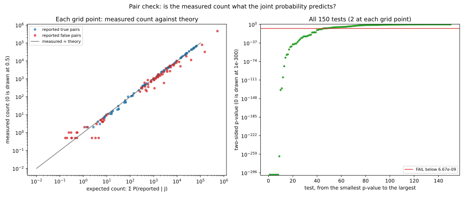
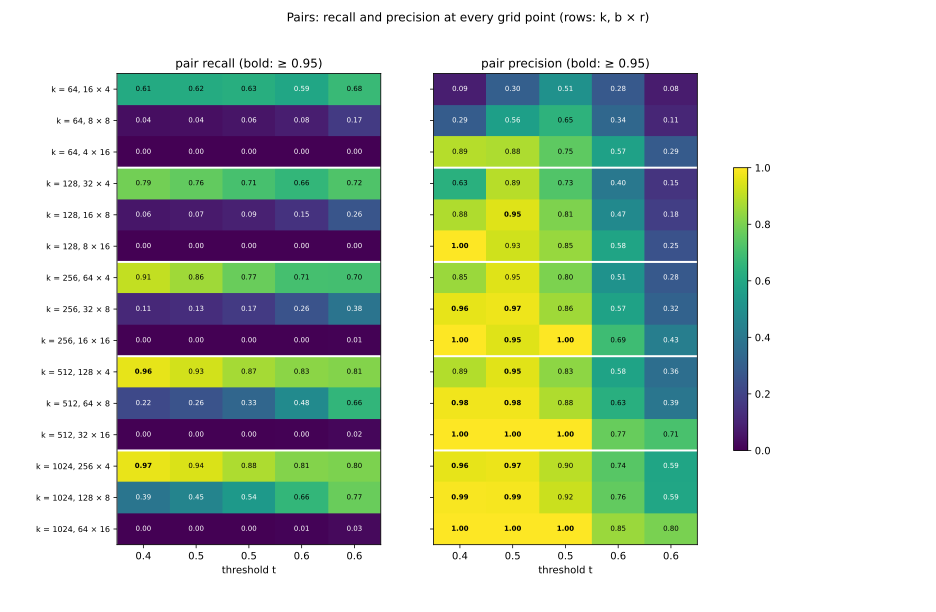
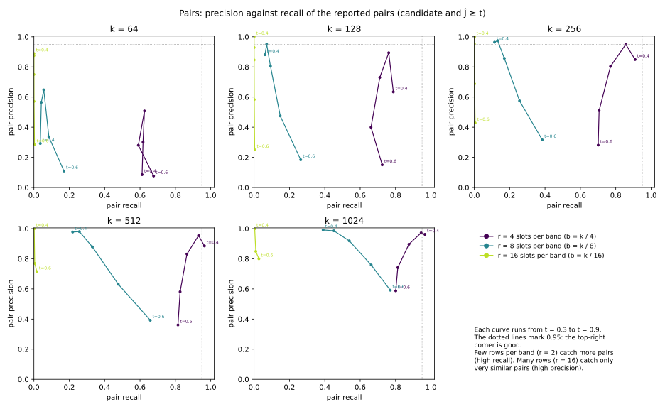
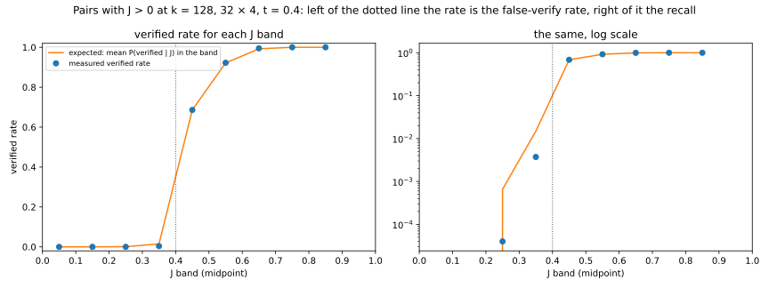
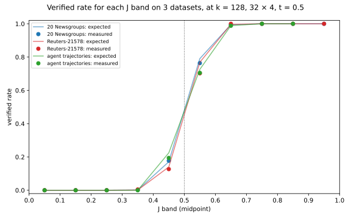
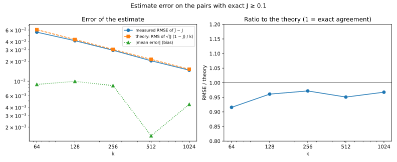
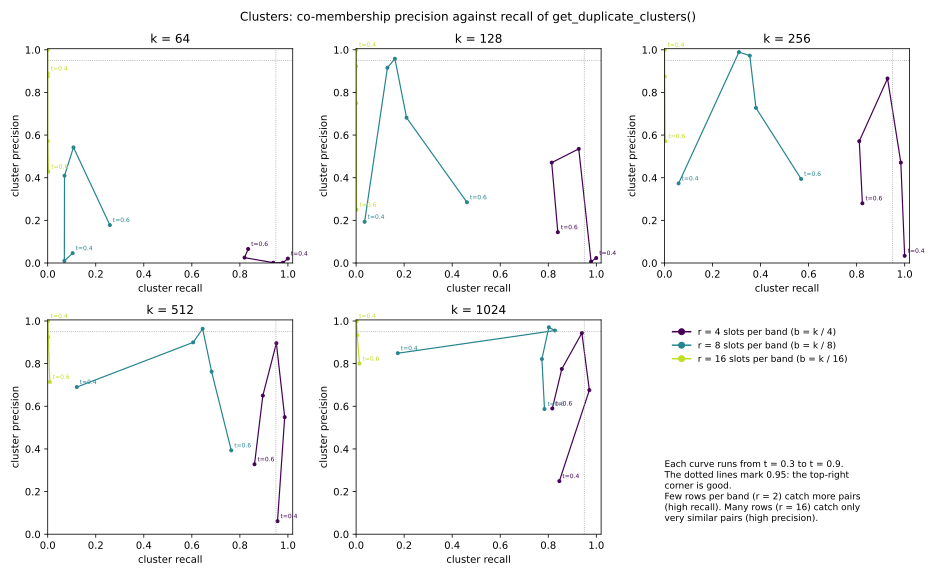
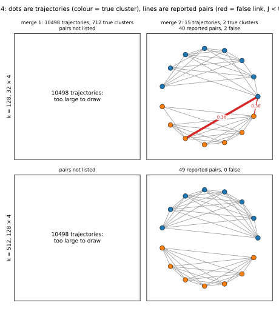
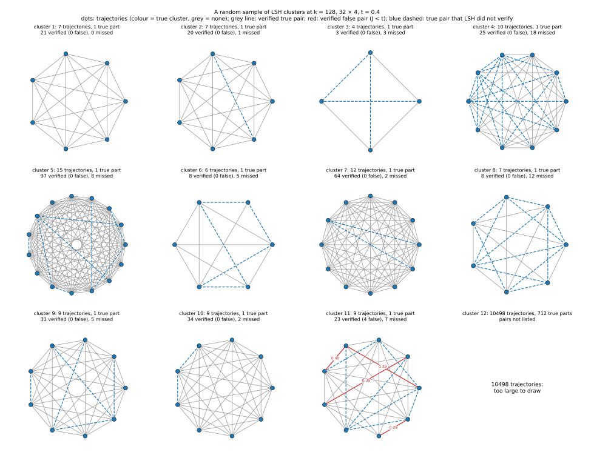
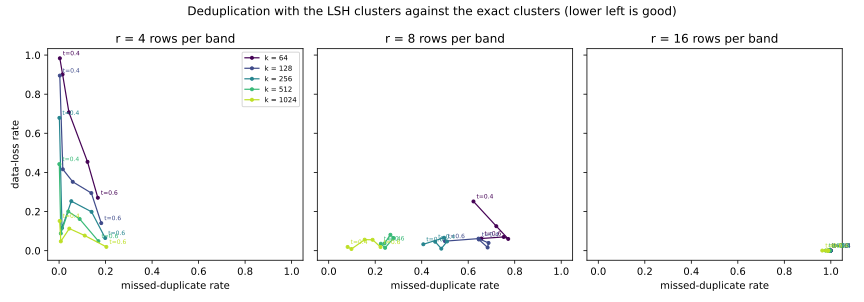

<!--
Licensed to the Apache Software Foundation (ASF) under one
or more contributor license agreements.  See the NOTICE file
distributed with this work for additional information
regarding copyright ownership.  The ASF licenses this file
to you under the Apache License, Version 2.0 (the
"License"); you may not use this file except in compliance
with the License.  You may obtain a copy of the License at

  http://www.apache.org/licenses/LICENSE-2.0

Unless required by applicable law or agreed to in writing,
software distributed under the License is distributed on an
"AS IS" BASIS, WITHOUT WARRANTIES OR CONDITIONS OF ANY
KIND, either express or implied.  See the License for the
specific language governing permissions and limitations
under the License.
-->

# Full-data precision and recall of the sketch and the LSH clusters on agent trajectories

Written by `build/lsh_trajectories_full` (`FULL=1 ./run_demos.sh`). The ticket is MH-15b. The tables for every grid point are in `lsh_trajectories_full_pairs.tsv`, `lsh_trajectories_full_clusters.tsv` and `lsh_trajectories_full_estimates.tsv`. `plots/lsh_20news_full.py` draws the figures from them.

## Definitions

- **Data point:** one trajectory. It is the set of its words: the runs of lower-case letters and digits that `demo::words` finds, in the agent's own tool-call arguments (the text that `analysis/trajectory_action_text.py` writes; tool replies are not used). An indexed trajectory has at least 1 word.
- **Pair:** two different indexed trajectories, in any order.
- **Exact J:** |A ∩ B| / |A ∪ B| of the two shingle sets. **Estimated J (Ĵ):** the share of the k slots whose values are equal.
- **True pair at t:** a pair with exact J ≥ t.
- **Candidate pair:** a pair whose band keys are equal in at least 1 band.
- **Verified pair:** a candidate pair with Ĵ ≥ t. The TSV columns `Reported`, `ReportedTrue` and `ReportedFalse`, and the word "reported" in the figures, mean the verified pairs.
- **Pair recall:** verified true pairs ÷ true pairs. **Pair precision:** verified true pairs ÷ verified pairs.
- **True cluster:** a connected group of 2 or more trajectories that true pairs link. **LSH cluster:** a connected group of 2 or more trajectories that verified pairs link (`get_duplicate_clusters()`).
- **Co-membership pair:** two trajectories in the same cluster. It includes trajectories that only a chain links, so their exact J can be below t.
- **Cluster recall:** the co-membership pairs that are in the true clusters and in the LSH clusters ÷ the co-membership pairs of the true clusters. **Cluster precision:** the same count ÷ the co-membership pairs of the LSH clusters. These are not the same quantities as pair recall and pair precision, because a cluster counts every pair that a chain links.
- **Merge:** an LSH cluster that joins 2 or more true clusters. Here a trajectory in no true cluster counts as a true cluster of its own. **Split:** a true cluster that LSH divides into 2 or more parts.
- **Index set and query set:** the held-out check splits the indexed trajectories in two. A trajectory goes to the index set when XXHash64 of its trajectory index (8 bytes, seed 2) is even, and to the query set otherwise. **Cross pair:** a pair with one trajectory in each set. **Query hit rate:** of the queries with at least 1 true cross pair, the share that get at least 1 verified true cross pair.
- **Kept set:** the trajectories that deduplication keeps: the smallest trajectory of each cluster, and every trajectory in no cluster. **Wrongly removed:** a trajectory that the exact clusters keep and the LSH clusters remove. **Missed duplicate:** a trajectory that the LSH clusters keep and the exact clusters remove. **Data-loss rate:** wrongly removed ÷ kept by the exact clusters. **Missed-duplicate rate:** missed duplicates ÷ removed by the exact clusters. These compare which trajectory each side keeps. When a merge and a split meet, LSH can keep another trajectory of the same true cluster, so both counts are upper bounds. **Lost true cluster:** a true cluster, or a trajectory in no true cluster, with no trajectory in the LSH kept set: real data loss. **Extra kept:** the LSH-kept trajectories beyond one for each true cluster that they cover: near-copies really left in.

## How deduplication works

MinHash does not store the trajectories or their items. The index keeps a copy of each trajectory's sketch, which is its k slot values, and a table of band keys, so that it can find likely near-duplicates fast. What to do with them, here deduplication, is the next step.

1. LSH finds the candidate pairs, and the program estimates Ĵ for each one.
2. A pair with Ĵ ≥ t is a near-duplicate, so it becomes a link. A pair below t is not a duplicate, so no link is made. The pruning removes links, not documents.
3. The links form clusters, which are groups of near-copies.
4. Deduplication keeps one document from each cluster and removes the others. A document in no cluster is kept as it is.
5. The downstream task, for example training or analysis, gets the kept documents.

## LSH guarantee

An LSH family is (r, cr, p1, p2)-sensitive if pairs at distance d ≤ r collide with probability at least p1, and pairs at distance d ≥ cr collide with probability at most p2. For MinHash the distance is the Jaccard distance d = 1 − J. One slot collides with probability exactly J = 1 − d, so p1 = 1 − r and p2 = 1 − cr. Bands amplify it. A pair is a candidate with probability f(J) = 1 − (1 − J^rows)^b. This curve rises with J, so for any r and c, p1 = f(1 − r) and p2 = f(1 − c·r). For example, at 32 bands × 4 rows: d ≤ 0.3 (J ≥ 0.7) gives p1 ≥ 0.9998; d ≥ 0.7 (J ≤ 0.3) gives p2 ≤ 0.2292.

In this definition, r is a distance radius. It is not the rows per band (r) of the grid. The S-curve check (MH-14, MH-19) and the pair check of this report test f as an equality at many values of J, which is stronger than the two inequalities.

## Data

- trajectories: 11166
- indexed trajectories (at least one shingle of 1 word): 11166
- pairs of indexed trajectories: 62334195
- pairs with exact J ≥ 0.35 (stored in the exact-pair cache): 233282
- pairs with 0 < J < 0.35 (counted in J bins of width 0.001, not stored): 62100913
- grid: k ∈ {64, 128, 256, 512, 1024}, r ∈ {4, 8, 16}, b = k / r, t ∈ {0.4, …, 0.6}: 75 points

Truth: a true pair at t has exact J ≥ t, with J from `news20::jaccard` on the word sets of the action text (`demo::words`, MH-E decision 1). The true clusters at t are the connected components of the true pairs. Verified pairs: the candidates (equal band keys in at least one band) with Ĵ ≥ t. The LSH clusters are `get_duplicate_clusters()`. The program asserts, at each grid point, that the components of the verified pairs equal them.

## Prefix assert: PASS

Each sketch is built directly at its k. For each k < 1024 and each indexed trajectory, the k signature must equal the first k slots of the k = 1024 signature.

- signatures checked: 44664
- signatures that differ: 0

## Identical word sets: PASS

Each pair of indexed trajectories with identical word sets must be in one true cluster and in one LSH cluster, at every grid point.

- pairs with identical word sets: 0
- (pair, grid point) cases not in one cluster: 0

## Pair check: report only (43 of 75 grid points pass)

P(verified | J) is the joint probability that some band is all-equal and at least m = ⌈t k⌉ slots are equal, with each slot equal independently with probability J. It is Σ_{s ≥ m} P(Binomial(k, J) = s) q(s), where q(s) is the probability that s uniformly placed equal slots fill some band (a dynamic program over the bands). At each grid point, two counts are tested with the exact two-sided Poisson-binomial p-value: the verified true pairs against Σ P(verified | J) over the true pairs (recall), and the verified false pairs against Σ P(verified | J) over the pairs with 0 < J < t (precision). Pairs with J = 0 add 0. A test passes when p ≥ 1e-06 / 150 = 6.67e-09. If the pairs were independent, a correct index would fail some test with a probability of at most 1e-06. They are not: pairs that share a trajectory use the same signature, so their outcomes are positively correlated, the counts spread more than the Poisson-binomial allows, and the p-values are too small. So this bound is not exact. Here the pair check is report only, and it does not enter `Overall`. MH-14 checks the S-curve on independent synthetic pairs.

The false count also includes the pairs below the floor: each bin adds its count times P(verified | J) at the middle of the bin. Because the exact Poisson-binomial program is too slow for so many pairs, the precision p-value is the two-sided normal approximation with a continuity correction. The recall p-value stays exact, because every true pair is stored.

The correlation is strong here, because all trajectories share a common vocabulary (the background J is about 0.27). A smoke-run diagnosis (2,000 trajectories, k = 128, 30 sketch seeds, a pair counted when Ĵ ≥ t) found that the mean counts over the seeds match the model, for example 1,954 against 1,951 verified true pairs at t = 0.4, but their spread is 5 to 400 times the independent-pair SD. The spread has a long right tail: at t = 0.4 the verified false pairs of the 30 seeds run from 690 to 38,030 (median 4,448, mean 6,807, expected 7,530), and 20 of the 30 seeds are below the mean. So one seed is usually below the model in the J bands under t, as in the band table below. A likely cause: when a common word has the smallest hash in a slot, that slot is equal for millions of pairs at once. So the p-values below say little, and `Overall` covers only the prefix assert, the identical-set check and the index-consistency assert. A better test is future work.

How to read it: on the left, each dot is one count at one grid point. A dot on the line means that the measured count equals the theory. On the right, the p-values of all tests are sorted. A test fails only below the red line.

| k | r | t | recall p | precision p |
|---:|---:|---:|---:|---:|
| 64 | 4 | 0.4 | 3.98e-67 | 0 |
| 64 | 4 | 0.45 | 7.4e-36 | 0 |
| 64 | 4 | 0.5 | 2.56e-21 | 0 |
| 64 | 8 | 0.45 | 7.21e-06 | 3.54e-39 |
| 128 | 4 | 0.4 | 0.925 | 0 |
| 128 | 4 | 0.45 | 1.15e-16 | 0 |
| 128 | 4 | 0.5 | 6.65e-17 | 3.03e-84 |
| 128 | 4 | 0.55 | 0.393 | 8.41e-51 |
| 128 | 4 | 0.6 | 0.000543 | 1.72e-10 |
| 128 | 8 | 0.4 | 0.0514 | 0 |
| 128 | 8 | 0.45 | 0.0169 | 2.22e-40 |
| 256 | 4 | 0.4 | 1.86e-16 | 0 |
| 256 | 4 | 0.45 | 1.47e-60 | 1.53e-131 |
| 256 | 4 | 0.5 | 8.1e-46 | 2.39e-106 |
| 256 | 4 | 0.55 | 0.000354 | 1.64e-61 |
| 256 | 8 | 0.4 | 2.2e-06 | 3.04e-128 |
| 256 | 8 | 0.5 | 3.23e-06 | 2.01e-10 |
| 256 | 8 | 0.55 | 0.147 | 8.89e-17 |
| 512 | 4 | 0.4 | 1.72e-08 | 6.91e-264 |
| 512 | 4 | 0.5 | 9.65e-25 | 0.784 |
| 512 | 4 | 0.55 | 7.75e-39 | 6.41e-22 |
| 512 | 4 | 0.6 | 1.28e-08 | 1.37e-40 |
| 512 | 8 | 0.4 | 0.902 | 6.16e-23 |
| 512 | 8 | 0.55 | 5.61e-12 | 3.31e-08 |
| 512 | 8 | 0.6 | 6.71e-06 | 4.21e-24 |
| 1024 | 4 | 0.4 | 1.01e-30 | 4.8e-306 |
| 1024 | 4 | 0.45 | 8.6e-25 | 5.7e-33 |
| 1024 | 4 | 0.5 | 1.22e-06 | 1.08e-44 |
| 1024 | 4 | 0.55 | 0.0875 | 1.14e-11 |
| 1024 | 8 | 0.4 | 6.27e-28 | 9.86e-25 |
| 1024 | 8 | 0.45 | 4.85e-27 | 0.00214 |
| 1024 | 8 | 0.5 | 3.82e-10 | 5.1e-09 |

## Recommended k

For each t: the smallest k with a (b, r) whose pair recall and pair precision are both ≥ 0.95. The best (b, r) at that k has the largest min(recall, precision), ties by the smaller r.

| t | k | b × r | recall | precision |
|---:|---:|---|---:|---:|
| 0.4 | 1024 | 256 × 4 | 0.9660 | 0.9619 |
| 0.45 | none reaches the target | - | - | - |
| 0.5 | none reaches the target | - | - | - |
| 0.55 | none reaches the target | - | - | - |
| 0.6 | none reaches the target | - | - | - |

## Pair recall and precision at each grid point

How to read it: each row is one (k, b × r), and each column is one t. Bright cells are near 1, and bold values are at least 0.95. Recall rises and precision falls as r gets smaller.

How to read it: one panel for each k, and one curve for each r. Each curve runs from t = 0.4 to t = 0.6. The dotted lines mark 0.95, so a point in the top-right corner meets the target of a recommended k.

Each cell is recall / precision. A FAIL marks a failed pair check.

| k | b × r | t = 0.4 | t = 0.45 | t = 0.5 | t = 0.55 | t = 0.6 |
|---:|---|---|---|---|---|---|
| 64 | 16 × 4 | 0.6117 / 0.0852 FAIL | 0.6171 / 0.3014 FAIL | 0.6252 / 0.5077 FAIL | 0.5906 / 0.2799 | 0.6769 / 0.0764 |
| 64 | 8 × 8 | 0.0362 / 0.2919 | 0.0420 / 0.5649 FAIL | 0.0558 / 0.6476 | 0.0848 / 0.3352 | 0.1701 / 0.1091 |
| 64 | 4 × 16 | 0.0001 / 0.8889 | 0.0001 / 0.8750 | 0.0002 / 0.7500 | 0.0006 / 0.5714 | 0.0034 / 0.2857 |
| 128 | 32 × 4 | 0.7874 / 0.6343 FAIL | 0.7613 / 0.8939 FAIL | 0.7108 / 0.7301 FAIL | 0.6613 / 0.3998 FAIL | 0.7245 / 0.1501 FAIL |
| 128 | 16 × 8 | 0.0615 / 0.8807 FAIL | 0.0713 / 0.9501 FAIL | 0.0927 / 0.8053 | 0.1480 / 0.4746 | 0.2636 / 0.1839 |
| 128 | 8 × 16 | 0.0002 / 1.0000 | 0.0002 / 0.9286 | 0.0004 / 0.8462 | 0.0011 / 0.5833 | 0.0034 / 0.2500 |
| 256 | 64 × 4 | 0.9094 / 0.8492 FAIL | 0.8567 / 0.9498 FAIL | 0.7704 / 0.8036 FAIL | 0.7059 / 0.5104 FAIL | 0.7007 / 0.2810 |
| 256 | 32 × 8 | 0.1148 / 0.9642 FAIL | 0.1324 / 0.9743 | 0.1701 / 0.8569 FAIL | 0.2561 / 0.5750 FAIL | 0.3844 / 0.3161 |
| 256 | 16 × 16 | 0.0003 / 1.0000 | 0.0004 / 0.9524 | 0.0006 / 1.0000 | 0.0017 / 0.6875 | 0.0051 / 0.4286 |
| 512 | 128 × 4 | 0.9644 / 0.8852 FAIL | 0.9311 / 0.9541 | 0.8654 / 0.8313 FAIL | 0.8267 / 0.5810 FAIL | 0.8146 / 0.3610 FAIL |
| 512 | 64 × 8 | 0.2193 / 0.9775 FAIL | 0.2572 / 0.9802 | 0.3305 / 0.8791 | 0.4773 / 0.6306 FAIL | 0.6582 / 0.3921 FAIL |
| 512 | 32 × 16 | 0.0007 / 1.0000 | 0.0009 / 1.0000 | 0.0016 / 1.0000 | 0.0047 / 0.7692 | 0.0170 / 0.7143 |
| 1024 | 256 × 4 | 0.9660 / 0.9619 FAIL | 0.9446 / 0.9721 FAIL | 0.8755 / 0.8965 FAIL | 0.8126 / 0.7416 FAIL | 0.8010 / 0.5873 |
| 1024 | 128 × 8 | 0.3904 / 0.9912 FAIL | 0.4514 / 0.9854 FAIL | 0.5384 / 0.9188 FAIL | 0.6622 / 0.7587 | 0.7704 / 0.5914 |
| 1024 | 64 × 16 | 0.0017 / 1.0000 | 0.0021 / 1.0000 | 0.0036 / 1.0000 | 0.0097 / 0.8493 | 0.0272 / 0.8000 |

## Verified rate for each J band

Report only. The pairs with J > 0 are cut into bands of width 0.1, and J = 1 is in the last band. The verified rate of a band depends only on the J values of its pairs, not on the mix of pairs in a dataset, so it is the figure to compare across datasets and with the theory. In a band at or above t, the verified rate is the recall for pairs of that J. In a band below t, it is the false-verify rate. The expected rate is the mean of P(verified | J) over the pairs of the band. All grid points are in `lsh_trajectories_full_bands.tsv`.

At k = 128, 32 × 4, t = 0.4:

| J band | pairs | verified | verified rate | expected rate |
|---|---:|---:|---:|---:|
| [0.0, 0.1) | 143 | 0 | 0.0000 | 0.0000 |
| [0.1, 0.2) | 745381 | 0 | 0.0000 | 0.0000 |
| [0.2, 0.3) | 53619516 | 2144 | 0.0000 | 0.0007 |
| [0.3, 0.4) | 7899689 | 29397 | 0.0037 | 0.0149 |
| [0.4, 0.5) | 39876 | 27359 | 0.6861 | 0.6865 |
| [0.5, 0.6) | 29002 | 26755 | 0.9225 | 0.9217 |
| [0.6, 0.7) | 585 | 582 | 0.9949 | 0.9924 |
| [0.7, 0.8) | 2 | 2 | 1.0000 | 1.0000 |
| [0.8, 0.9) | 1 | 1 | 1.0000 | 1.0000 |
| [0.9, 1.0] | 0 | 0 | - | - |

How to read it: the dots are the measured verified rate of each band, and the line is the expected rate. The dotted line marks t. Right of it, the rate is the recall for pairs of that J; left of it, the rate is the false-verify rate. The right panel shows the same rates on a log scale, so small rates are visible (a band with no verified pair is not drawn there).

How to read it: the verified rate of each J band at k = 128, 32 × 4, t = 0.5 (a grid point of all three reports), on 20 Newsgroups (blue, from `lsh_20news_full_bands.tsv`), Reuters-21578 (red, from `lsh_reuters_full_bands.tsv`) and the agent trajectories (green). The dots are the measured rates, and the lines are the expected rates of each dataset. All three datasets use the same word tokenizer. The expected lines differ a little in the steep bands near t, because the mix of J values inside a band differs between the datasets.

## Held-out queries

The sections above index every trajectory and cluster them, which is the use case "find near-copies inside a corpus". This section tests the other use case: build the index once, then query it with trajectories that it has never seen. The index holds only the index set (5654 trajectories). Each trajectory of the query set (5512 trajectories) calls `query_candidates()`, and the candidates with Ĵ ≥ t are verified. The program asserts that the candidates equal the band-key bucket rule computed in the demo. Only the cross pairs count. The p-values are report only, with no PASS or FAIL. The data is in `lsh_trajectories_full_heldout.tsv`.

| setting | k | b × r | t | true cross pairs | query recall | in-sample recall | query precision | in-sample precision | verified true: measured / expected | verified false: measured / expected | p recall | p precision | query hit rate |
|---|---:|---|---:|---:|---:|---:|---:|---:|---:|---:|---:|---:|---:|
| MH-E1 setting | 128 | 32 × 4 | 0.4 | 34717 | 0.7854 | 0.7874 | 0.6331 | 0.6343 | 27268 / 27315.9 | 15804 / 76409.1 | 0.496 | 0 | 0.9808 (5369 of 5474) |
| recommended at t = 0.4 | 1024 | 256 × 4 | 0.4 | 34717 | 0.9656 | 0.9660 | 0.9625 | 0.9619 | 33521 / 33748.3 | 1305 / 2509.7 | 6.26e-18 | 1.43e-161 | 0.9987 (5467 of 5474) |

How to read it: query recall and precision should be close to the in-sample figures of the same setting, because a query trajectory meets the same band keys and the same Ĵ test as an indexed trajectory. The measured and expected counts should agree, as in the pair check. The query hit rate says how often a new trajectory with a near-copy in the index finds at least one of them.

## Estimate error

On the stored pairs with exact J ≥ 0.35. The ratio is the RMSE divided by the RMS of √(J (1 − J) / k), so 1 is the theory.

How to read it: on the left, the measured RMSE (blue) lies on the theory (orange), and it halves when k grows 4 times. The bias (green) is much smaller than the RMSE. On the right, the ratio is near 1 at every k.

| k | pairs | mean error | RMSE | RMS theory SD | ratio |
|---:|---:|---:|---:|---:|---:|
| 64 | 233282 | 0.008920 | 0.055589 | 0.060711 | 0.9156 |
| 128 | 233282 | -0.009921 | 0.041255 | 0.042929 | 0.9610 |
| 256 | 233282 | -0.008551 | 0.029501 | 0.030356 | 0.9719 |
| 512 | 233282 | -0.001474 | 0.020411 | 0.021465 | 0.9509 |
| 1024 | 233282 | -0.004436 | 0.014686 | 0.015178 | 0.9676 |

## Clusters at k = 128, 32 × 4, t = 0.4 (the MH-E1 setting)

Co-membership: a pair of trajectories is in one cluster. A trajectory alone counts as a component of its own, so a merge can join a true cluster and a trajectory that is in no true cluster. All grid points are in `lsh_trajectories_full_clusters.tsv`.

How to read it: as the pair figure, but for pairs of trajectories in one cluster of `get_duplicate_clusters()` against pairs in one true cluster.

- LSH clusters: 72; true clusters: 774
- co-membership precision: 0.0233 (1283172 of 55101614 pairs)
- co-membership recall: 0.9997 (1283172 of 1283608 pairs)
- merges (LSH clusters that join 2 or more true components): 2
- splits (true clusters that LSH splits): 30
- largest LSH cluster: 10498 trajectories; largest true cluster: 1550 trajectories

The 5 worst merges (most true components, then most trajectories), each with its weakest link: the verified pair of the cluster with the lowest exact J.

| true components | trajectories | weakest link | exact J | 3 shared shingles |
|---:|---:|---|---:|---|
| 712 | 10498 | `einsteinpy__einsteinpy-357/chatcmpl-225f08b0882cd572435bc46f6fd143da`, `zarr-developers__VirtualiZarr-179/chatcmpl-cf86d0e65411bc810eb45ceaf4297549` | 0.2456 | `0`, `1`, `10` |
| 2 | 15 | `feder-observatory__stellarphot-233/chatcmpl-06504aef109b62fcb5ea28d2a77f05e3`, `feder-observatory__stellarphot-470/chatcmpl-244e9e387beb16e37a025406a4010a21` | 0.3603 | `0`, `01`, `1` |

How to read it: each column is one merge of the table above, in the same order. Each dot is a trajectory, coloured by its true cluster at t = 0.4. Each line is a verified pair, labelled with its exact J. A grey line joins trajectories of one true cluster. A red line has J < t, so it is a false link that joins 2 true clusters, and the thickest red line is the weakest link. The top row is the MH-E1 setting (k = 128, 32 × 4). The bottom row shows the same trajectories at k = 512, 128 × 4, with only the pairs among these trajectories. The data is in `lsh_trajectories_full_merges.tsv`.

### A random sample of the clusters

12 of the 69 LSH clusters with at least 3 trajectories at this setting, chosen by the smallest XXHash64 (seed 1) of the smallest trajectory index of each cluster. 1 of them contain a merge.

How to read it: each panel is one LSH cluster. Each dot is a trajectory, coloured by its true cluster at t = 0.4, and a grey dot is in no true cluster. A solid line is a verified pair, labelled with its exact J, and it is red when J < t. A dashed line is a true pair (J ≥ t) between drawn trajectories that LSH did not verify; the chain still puts both trajectories in the cluster. The data is in `lsh_trajectories_full_sample_clusters.tsv`.

## Kept set (deduplication)

The same deduplication runs twice at each grid point: once on the true clusters, and once on the LSH clusters. Each keeps the smallest trajectory of each cluster and every trajectory in no cluster. The comparison shows what LSH costs a downstream task: trajectories lost by mistake, and near-copies left in. All grid points are in `lsh_trajectories_full_kept.tsv`.

| setting | k | b × r | t | trajectories | kept (exact) | kept (LSH) | wrongly removed | missed duplicates | data-loss rate | missed-duplicate rate | lost true clusters | extra kept |
|---|---:|---|---:|---:|---:|---:|---:|---:|---:|---:|---:|---:|
| MH-E1 setting | 128 | 32 × 4 | 0.4 | 11166 | 791 | 115 | 708 | 32 | 0.8951 | 0.0031 | 692 | 16 |
| recommended at t = 0.4 | 1024 | 256 × 4 | 0.4 | 11166 | 791 | 696 | 120 | 25 | 0.1517 | 0.0024 | 115 | 20 |

How to read it: one panel for each r, and one curve for each k, with a point for each t. Lower left is good. A point high on the y axis removes trajectories that have no near-copy (data loss, mostly from merges). A point far right keeps near-copies that should go (missed duplicates, mostly from splits).

## Same-instance proxy (report only)

The data has no similarity labels. The proxy says that two trajectories of the same task instance are related. It is not the truth of this report (the truth is exact J ≥ t), and different instances can still share a near-identical path.

- proxy pairs (two trajectories of one group): 65505

Each cell is precision / recall against the proxy: the share of the pairs that are proxy pairs, and the share of the proxy pairs that they cover. True pairs and true clusters use the exact J, so they show the gap between the item and the proxy. Verified pairs and LSH clusters add the error of the sketch. At k = 128, 32 × 4; all grid points are in `lsh_trajectories_full_proxy.tsv`.

| t | true pairs | verified pairs | true clusters | LSH clusters |
|---:|---|---|---|---|
| 0.4 | 0.9161 / 0.9715 | 0.6040 / 0.7952 | 0.0508 / 0.9963 | 0.0012 / 0.9927 |
| 0.45 | 0.9820 / 0.8246 | 0.9363 / 0.6695 | 0.8556 / 0.9700 | 0.0060 / 0.9587 |
| 0.5 | 0.9839 / 0.4444 | 0.9823 / 0.4320 | 0.9832 / 0.7364 | 0.6202 / 0.8045 |
| 0.55 | 0.9961 / 0.0977 | 0.9920 / 0.1609 | 0.9900 / 0.2238 | 0.9792 / 0.3828 |
| 0.6 | 1.0000 / 0.0090 | 0.9965 / 0.0432 | 1.0000 / 0.0173 | 0.9950 / 0.1004 |

## The 20 true pairs with the highest J

Ties by trajectory index. The shingles show whether quoted text or boilerplate makes the pairs similar.

| trajectories | exact J | 3 shared shingles |
|---|---:|---|
| `matchms__matchms-539/chatcmpl-2f6142fb49e38d68cb188a1a10c2b088`, `matchms__matchms-539/chatcmpl-e9a5f77cfe1ed821386fe6c458641397` | 0.8071 | `0`, `003174`, `010132` |
| `matchms__matchms-539/chatcmpl-d3bbe409be4b6e0fa4132c2943fc4539`, `matchms__matchms-539/chatcmpl-e9a5f77cfe1ed821386fe6c458641397` | 0.7912 | `0`, `003174`, `010132` |
| `matchms__matchms-539/chatcmpl-2f6142fb49e38d68cb188a1a10c2b088`, `matchms__matchms-539/chatcmpl-d3bbe409be4b6e0fa4132c2943fc4539` | 0.7832 | `0`, `003174`, `010132` |
| `joblib__joblib-985/chatcmpl-66eede70d32873ecfe57968c4ec7edf1`, `joblib__joblib-985/chatcmpl-7ab3807cfd4b97231125cc084590fc61` | 0.6830 | `0`, `1`, `10` |
| `ESMValGroup__ESMValCore-2668/chatcmpl-8937567d8b1e3361023b5260c4ab6241`, `ESMValGroup__ESMValCore-2668/chatcmpl-df7a883f2062f587fb74a29b5ced7f20` | 0.6814 | `0`, `00`, `01` |
| `joblib__joblib-985/chatcmpl-66eede70d32873ecfe57968c4ec7edf1`, `joblib__joblib-985/chatcmpl-e9984231c5151bf3fd0a59e65087c373` | 0.6753 | `0`, `1`, `10` |
| `matchms__matchms-539/chatcmpl-569ba3875aee110913b954461883562d`, `matchms__matchms-539/chatcmpl-70b4e62b00b68a7646c303a0a2121a83` | 0.6740 | `0`, `05`, `1` |
| `PyPSA__PyPSA-891/chatcmpl-53672ff6a980e8d7e9972c30612e1308`, `PyPSA__PyPSA-891/chatcmpl-744870c99b888609632fea71f83ad069` | 0.6729 | `0`, `1`, `10` |
| `bridgecrewio__checkov-2214/chatcmpl-13062dbeb11eba6fa33b5ca890648597`, `bridgecrewio__checkov-2214/chatcmpl-32f38ae56867c0eaf7f9b11c97fa2198` | 0.6697 | `0`, `1`, `10` |
| `fatiando__verde-357/chatcmpl-0ea6869cda6fa00ed7522140d91e370e`, `fatiando__verde-357/chatcmpl-79e1e7561a8943c3e0cb80543ac64d77` | 0.6689 | `0`, `1`, `10` |
| `joblib__joblib-985/chatcmpl-66eede70d32873ecfe57968c4ec7edf1`, `joblib__joblib-985/chatcmpl-e60df9c45c287858b8a0d50fe07a701e` | 0.6683 | `0`, `1`, `10` |
| `fatiando__verde-357/chatcmpl-79e1e7561a8943c3e0cb80543ac64d77`, `fatiando__verde-357/chatcmpl-d73f2a71864b18e586a5d843d1c14e51` | 0.6678 | `0`, `1`, `10` |
| `fsspec__filesystem_spec-1419/chatcmpl-003f4c87811fef3421d3589f42cc93c4`, `fsspec__filesystem_spec-1419/chatcmpl-eb652a2275d0380ef8b24305a3db15bc` | 0.6675 | `0`, `1`, `10` |
| `PyPSA__PyPSA-891/chatcmpl-8e319b4e68a398d4a819198bee259386`, `PyPSA__PyPSA-891/chatcmpl-bc81fc4d36a2c461eb6b3635b52c16bb` | 0.6674 | `0`, `01`, `1` |
| `fatiando__verde-357/chatcmpl-02ac5113d960e5886a8a59a7dfd56e68`, `fatiando__verde-357/chatcmpl-79e1e7561a8943c3e0cb80543ac64d77` | 0.6672 | `0`, `1`, `10` |
| `ianlini__flatten-dict-13/chatcmpl-7c4b6a60dad95cb79b5d4b773f5f0f4b`, `ianlini__flatten-dict-13/chatcmpl-bcb15219b851427aa5ccfaebe11883b0` | 0.6633 | `0`, `1`, `10` |
| `developmentseed__cogeo-mosaic-232/chatcmpl-01c749afa53b44ccc439c48eba18e5a5`, `developmentseed__cogeo-mosaic-232/chatcmpl-63acce3da4e0067c128e53d583072c8c` | 0.6618 | `0`, `06`, `1` |
| `bridgecrewio__checkov-2214/chatcmpl-52a422b01f3813d151afc3d429d3f53d`, `bridgecrewio__checkov-2214/chatcmpl-8a4e334c2d9359a6e68547f1b95a4dbe` | 0.6618 | `0`, `1`, `10` |
| `joblib__joblib-985/chatcmpl-6fa1ddad84dc9577c945cdc2c0f499f5`, `joblib__joblib-985/chatcmpl-e9984231c5151bf3fd0a59e65087c373` | 0.6609 | `0`, `1`, `10` |
| `joblib__joblib-985/chatcmpl-3ce537b6babe86ef15473280b22074b8`, `joblib__joblib-985/chatcmpl-e9984231c5151bf3fd0a59e65087c373` | 0.6583 | `0`, `1`, `10` |

Overall: PASS
